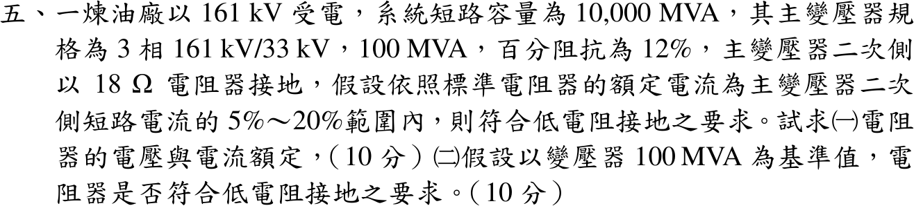

# 111 年工業配電第 5 題｜低電阻接地電阻器額定與短路電流比例

## 已知與所求

161 kV 受電，系統短路容量 \(10000\,\mathrm{MVA}\)；主變壓器 \(161/33\,\mathrm{kV}\)、\(100\,\mathrm{MVA}\)、\(Z=12\%\)；二次側中性點經 \(18\,\Omega\) 電阻接地。電阻器額定電流為二次側短路電流的 5%～20% 即符合低電阻接地。求（一）電阻器電壓與電流額定；（二）以 100 MVA 為基準判斷是否符合。

## 考場標準作答

### （一）電阻器額定

觀念：中性點接地電阻在單相接地故障時，跨在故障相的相電壓上（三相電壓平衡時中性點電壓為零，故障時升至相電壓），電阻器電壓額定取相電壓，電流額定由歐姆定律求得。畫法：二次側 Y 接中性點經 \(18\ \Omega\) 接地，故障相電源電壓全數加在 \(R\) 上（忽略變壓器與系統阻抗）。
\[
V_R=\frac{V_{LL}}{\sqrt3}=\frac{33}{\sqrt3}=\boxed{19.05\,\mathrm{kV}}
\]
\[
I_R=\frac{V_R}{R}=\frac{19052.56\ \mathrm V}{18\ \Omega}=\boxed{1058.48\,\mathrm A}
\]

### （二）低電阻接地判定

觀念：低電阻接地的判準是電阻器額定電流佔二次側三相短路電流的 5%～20%，故先在 100 MVA 基準下求二次側三相短路電流，再取比值。
\[
X_s=\frac{S_b}{S_{sc}}=\frac{100}{10000}=0.01\ \mathrm{pu},\qquad X_T=12\%=0.12\ \mathrm{pu}
\]
\[
I_b=\frac{S_b}{\sqrt3V_b}=\frac{100\times10^6}{\sqrt3(33\times10^3)}=1749.55\,\mathrm A
\]
\[
I_{sc}=\frac{I_b}{X_s+X_T}=\frac{1749.55}{0.01+0.12}=\frac{1749.55}{0.13}=\boxed{13.46\,\mathrm{kA}}
\]
\[
\frac{I_R}{I_{sc}}=\frac{1058.48}{13458.05}=\boxed{7.87\%}\in[5\%,20\%]\ \Rightarrow\ \text{符合低電阻接地}
\]

## 驗算

以對稱分量求經電阻的單線接地電流（Δ-Y 變壓器 \(Z_0=jX_T\)，\(Z_b=33^2/100=10.89\,\Omega\)，\(3R/Z_b=54/10.89=4.96\,\mathrm{pu}\)）：
\[
I_{SLG}=\frac{3I_b}{|4.96+j(0.13+0.13+0.12)|}=\frac{3(1749.55)}{4.97}=1055.38\,\mathrm A
\]
與 \(V_R/R=1058.48\,\mathrm A\) 相差 0.29%，確認電阻主導接地電流。

## 失分點

- 電阻器電壓用線電壓 33 kV；中性點只承受相電壓。
- 漏掉系統電抗 0.01，二次短路電流變為 14.58 kA，比例 7.26%（結論仍符合，但數值錯）。
