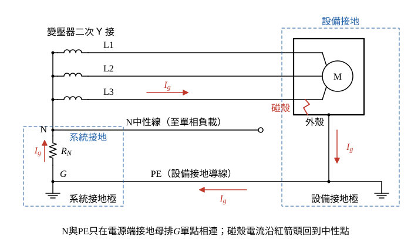

# 112 年工業配電第 1 題｜系統接地與設備接地

## 已知與所求

（一）試述系統接地與設備接地之方法與目的（10 分）；（二）繪出兩種接地作法（10 分）。

## 考場標準作答

**解題邏輯**：兩種接地的差別在「接地對象」：系統接地接的是電源（發電機或變壓器）的中性點，管的是系統對地電位與接地故障電流；設備接地接的是正常不帶電的金屬外殼，管的是人員安全與故障回路。（一）分別寫方法（接法、接地方式種類）與目的；（二）把兩者畫在同一張接線圖上，並以碰殼故障電流的路徑說明兩者如何合作。以低壓 Y 接系統、中性點經電阻接地為例（直接接地或電抗接地只換掉圖中 \(R_N\)）。

### （一）方法與目的（10 分）

**邏輯**：按「接地對象 → 接法 → 目的」分開寫兩種接地，目的各對應一個工程效果（電位、故障電流、人身安全）。

**系統接地**

- 方法：將發電機或變壓器的中性點（無中性點時以接地變壓器建立人工中性點）接至接地電極。依中性點對地阻抗分為直接（低阻抗）接地、低電阻接地、高電阻接地、電抗接地；另有不接地系統（須配絕緣監視）。
- 目的：
  - 固定系統對地電位，抑制中性點漂移與間歇性接地造成的暫態過電壓；
  - 限制並確定接地故障電流大小，使接地電驛（51N 等）能選擇性跳脫；
  - 作為絕緣協調與避雷器額定電壓選定的依據。

**設備接地**

- 方法：以連續、截面足夠的設備接地導線（PE）把馬達外殼、配電盤體、金屬管槽、電纜鎧裝等正常不帶電的金屬部分連到接地母排與接地電極，並作等電位連結。
- 目的：
  - 絕緣破壞時降低外殼對地電壓，防止感電；
  - 提供低阻抗故障回路，使斷路器、熔絲或漏電斷路器迅速動作；
  - 降低接觸電壓與跨步電壓，減少火災與電弧危害。

\[
\boxed{\text{系統接地：中性點接地，控制系統電位與故障電流；設備接地：外殼經 PE 接地，保護人員並促成跳脫}}
\]

### （二）兩種接地作法（10 分）

**邏輯**：圖上要看得出兩種接地的接地對象不同——系統接地由電源中性點引出，設備接地由負載外殼引出——並畫出兩者在電源端單點相連，碰殼電流才有回路。

畫法（對照圖 1）：

- 系統接地：變壓器二次 Y 接，三繞組一端共接成中性點 N；由 N 向下經接地電阻 \(R_N\) 接到接地母排 \(G\)，再接系統接地極。N 另以中性線引至單相負載（正常帶負載電流）。
- 設備接地：三相線 L1、L2、L3 接馬達；馬達金屬外殼以 PE 線接回接地母排 \(G\)，PE 線上另設設備接地極。
- N 與 PE 只在電源端接地母排 \(G\) 單點相連，下游不再互接。
- 碰殼故障（以 L3 碰殼為例）：故障電流 \(I_g\) 依 L3 → 外殼 → PE → \(G\) → \(R_N\) → N → 繞組流回，兩種接地共同構成故障回路。

\[
\boxed{\text{系統接地：中性點 N 經 }R_N\text{ 接地；設備接地：外殼以 PE 連至接地母排與電極}}
\]

## 驗算

故障路徑檢查（圖 1 紅箭頭）：相線碰殼時電流 L3 → 外殼 → PE → 接地母排 \(G\) → \(R_N\) → 變壓器中性點 → 回到電源，迴路閉合；若缺系統接地，碰殼電流沒有金屬回路（只剩經對地電容的小電流），保護不動作、故障持續存在；若缺設備接地，外殼對地電壓接近相電壓。

## 失分點

- 把中性線 N 當作 PE 使用；N 正常有負載電流，PE 正常無電流。
- 只寫「接地」而未分開接地對象（中性點 vs. 外殼）。
- 圖中在下游多處重複連接 N 與 PE，形成並聯迴流路徑。
