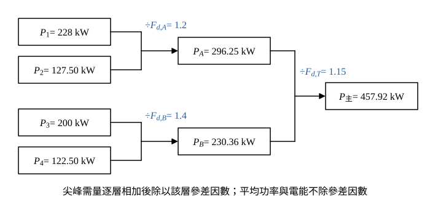

# 112 年工業配電第 2 題｜負載特性與需量計算

## 已知與所求

| 變壓器 | 設備 | kVA | PF | 需量因數 | 負載因數 | 設備間參差因數 |
|---|---|---:|---:|---:|---:|---:|
| A | 1 | 300 | 0.95 | 0.80 | 0.70 | 1.2 |
| A | 2 | 250 | 0.85 | 0.60 | 0.60 | 1.2 |
| B | 3 | 500 | 0.80 | 0.50 | 0.40 | 1.4 |
| B | 4 | 250 | 0.70 | 0.70 | 0.50 | 1.4 |

變壓器間參差因數 1.15。求（一）各設備最高需量 kW；（二）各變壓器最小容量 kW；（三）總平均功率 kW；（四）全月用電度數。

## 考場標準作答

**解題邏輯**：四個小題沿同一條「設備 → 變壓器 → 主變壓器」需量鏈往上算。（一）設備尖峰 = 連接容量（kVA × PF 換成 kW）× 需量因數；（二）同一變壓器下各設備尖峰不同時，群組尖峰 = 設備尖峰和 ÷ 設備間參差因數，主變壓器再 ÷ 變壓器間參差因數；（三）平均功率 = 尖峰 × 負載因數，平均值可直接相加、不除參差因數；（四）電能 = 平均功率 × 全月時數。

### （一）各設備的最高需量（5 分）

**邏輯**：需量因數 = 最高需量 ÷ 連接負載，連接負載以 kW 計為 \(S\times\mathrm{PF}\)，故 \(P_{\max}=S\times\mathrm{PF}\times\mathrm{DF}\)。

\[
P_{\max}=S\times\mathrm{PF}\times\mathrm{DF}
\]
\[
P_1=300\times0.95\times0.80=285\times0.80=228\ \mathrm{kW}
\]
\[
P_2=250\times0.85\times0.60=212.5\times0.60=127.50\ \mathrm{kW}
\]
\[
P_3=500\times0.80\times0.50=400\times0.50=200\ \mathrm{kW}
\]
\[
P_4=250\times0.70\times0.70=175\times0.70=122.50\ \mathrm{kW}
\]
\[
\boxed{P_1=228,\ P_2=127.50,\ P_3=200,\ P_4=122.50\ \mathrm{kW}}
\]

### （二）各變壓器的最小容量（5 分）

**邏輯**：變壓器只需承擔所屬設備的「合成尖峰」；參差因數 = 個別尖峰和 ÷ 合成尖峰 \(\ge1\)，所以用除的。主變壓器以 A、B 的合成尖峰再除變壓器間參差因數。

變壓器 A（設備 1、2，\(F_{d,A}=1.2\)）：
\[
P_A=\frac{P_1+P_2}{F_{d,A}}=\frac{228+127.50}{1.2}=\frac{355.50}{1.2}=296.25\ \mathrm{kW}
\]
變壓器 B（設備 3、4，\(F_{d,B}=1.4\)）：
\[
P_B=\frac{P_3+P_4}{F_{d,B}}=\frac{200+122.50}{1.4}=\frac{322.50}{1.4}=\frac{3225}{14}=230.36\ \mathrm{kW}
\]
主變壓器（\(F_{d,T}=1.15\)，\(P_B\) 保留分數形式往下算）：
\[
P_A+P_B=296.25+\frac{3225}{14}=\frac{4147.5+3225}{14}=\frac{7372.5}{14}
\]
\[
P_{\text{主}}=\frac{P_A+P_B}{F_{d,T}}=\frac{7372.5}{14\times1.15}=\frac{7372.5}{16.1}=457.92\ \mathrm{kW}
\]
\[
\boxed{P_A=296.25\ \mathrm{kW},\ P_B=230.36\ \mathrm{kW},\ P_{\text{主}}=457.92\ \mathrm{kW}}
\]

### （三）總平均功率（5 分）

**邏輯**：負載因數 = 平均功率 ÷ 最高需量，故 \(P_{avg,i}=P_i\times\mathrm{LF}_i\)；平均功率是能量的時間平均，全廠平均 = 各設備平均直接相加，參差因數只影響尖峰。

\[
P_{avg,i}=P_i\times\mathrm{LF}_i
\]
\[
P_{avg,1}=228\times0.70=159.60\ \mathrm{kW},\qquad P_{avg,2}=127.50\times0.60=76.50\ \mathrm{kW}
\]
\[
P_{avg,3}=200\times0.40=80\ \mathrm{kW},\qquad P_{avg,4}=122.50\times0.50=61.25\ \mathrm{kW}
\]
\[
P_{avg}=159.60+76.50+80+61.25=236.10+141.25
\]
\[
\boxed{P_{avg}=377.35\ \mathrm{kW}}
\]

### （四）全月用電度數（5 分）

**邏輯**：電能 = 平均功率 × 時間；題目未給全月日數，以 30 日、每日 24 h 計（31 日分支見條件與疑義）。

\[
E=P_{avg}\times24\times30=377.35\times720
\]
\[
\boxed{E=271\,692\ \mathrm{kWh}}
\]

## 驗算

逐設備日電量 \((159.60+76.50+80+61.25)\times24=377.35\times24=9056.40\ \mathrm{kWh}\)，\(9056.40\times30=271\,692\ \mathrm{kWh}\)。系統負載因數 \(377.35/457.92=0.8241<1\)，合理。

## 失分點

- 平均功率再除以參差因數；參差因數只用於尖峰需量。
- 變壓器容量用 kVA 作答；題目指定 kW。
- 全月只乘 24 h（漏乘日數）。

## 條件與疑義

「全月」日數題目未給，此處取 30 日；若取 31 日則 \(377.35\times744=280\,748.40\ \mathrm{kWh}\)。
