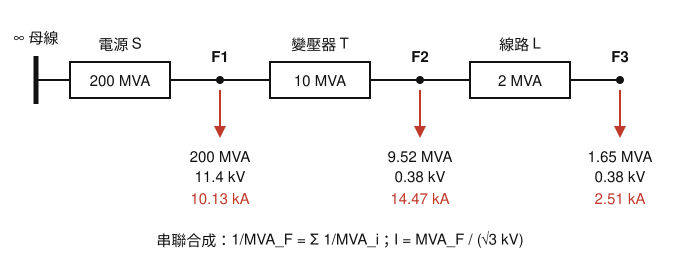

# 112 年工業配電第 3 題｜MVA 法求斷路器對稱啟斷電流

## 已知與所求

放射狀系統（圖二）：電源短路容量 \(200\,\mathrm{MVA}\)；F1 位於電源與變壓器之間（11.4 kV 側）；變壓器 \(1000\,\mathrm{kVA}\)、\(Z=10\%\)、\(11.4\,\mathrm{kV}/380\,\mathrm V\)，二次側母線為 F2；F2 母線經 \(0.0722\,\Omega\) 線路接到 F3 母線（380 V）。省略馬達倒灌電流。以 MVA 法求 F1、F2、F3 三相短路時斷路器的對稱啟斷電流（20 分）。

## 考場標準作答

**解題邏輯**：MVA 法把每個元件換成「自身短路容量」\(\mathrm{MVA}_i\)，串聯元件依 \(1/\mathrm{MVA}=\sum 1/\mathrm{MVA}_i\) 合成（如同電阻並聯），得故障點短路容量 \(\mathrm{MVA}_F\)，再以故障點所在電壓 \(I=\mathrm{MVA}_F/(\sqrt3\,\mathrm{kV})\) 換成對稱啟斷電流。三個故障點共用同一串元件，所以先求各元件 MVA、再由電源往下逐點累積合成，最後分點換算電流。省略馬達倒灌，系統只有上游電源一個饋入點，故障點下游元件不貢獻短路電流。

### 步驟 1：單線圖化為 MVA 串聯鏈

- 電源以「無限大母線串一個 \(200\,\mathrm{MVA}\) 元件」表示。
- 依圖二由上而下：電源 S → F1 → 變壓器 T → F2 → 線路 L → F3，三元件串成一條。
- 某故障點的短路容量 = 該點**上游**所有元件串聯合成；下游元件無電源，不計入。

### 步驟 2：各元件的短路 MVA

電源（題目直接給定）：
\[
\mathrm{MVA}_S=200\,\mathrm{MVA}
\]
變壓器：額定容量除以標么阻抗，\(1000\,\mathrm{kVA}=1\,\mathrm{MVA}\)：
\[
\mathrm{MVA}_T=\frac{\mathrm{MVA}_{\mathrm{rated}}}{Z_{\mathrm{pu}}}=\frac{1}{0.10}=10\,\mathrm{MVA}
\]
線路：以歐姆值換算，電壓取線路所在的 380 V（\(0.38\,\mathrm{kV}\)）：
\[
\mathrm{MVA}_L=\frac{\mathrm{kV}^2}{Z_\Omega}=\frac{0.38^2}{0.0722}=\frac{0.1444}{0.0722}=2\,\mathrm{MVA}
\]

### 步驟 3：逐點串聯合成故障點短路容量

（以完整精度往下算，只顯示兩位小數。）

F1 上游只有電源：
\[
\mathrm{MVA}_{F1}=\mathrm{MVA}_S=200\,\mathrm{MVA}
\]
F2 上游為 S、T 串聯：
\[
\frac{1}{\mathrm{MVA}_{F2}}=\frac{1}{200}+\frac{1}{10}=0.005+0.1=0.105
\]
\[
\mathrm{MVA}_{F2}=\frac{1}{0.105}=\frac{200\times10}{200+10}=\frac{2000}{210}=9.52\,\mathrm{MVA}
\]
F3 上游為 S、T、L 串聯（等於 \(\mathrm{MVA}_{F2}\) 再串 \(\mathrm{MVA}_L\)）：
\[
\frac{1}{\mathrm{MVA}_{F3}}=\frac{1}{200}+\frac{1}{10}+\frac{1}{2}=0.105+0.5=0.605
\]
\[
\mathrm{MVA}_{F3}=\frac{1}{0.605}=1.65\,\mathrm{MVA}
\]

電流換算分母：\(\sqrt3\times11.4=19.75\)、\(\sqrt3\times0.38=0.66\)（顯示兩位小數；下列各式以完整精度的 \(\mathrm{MVA}_F\) 與分母計算）。

### F1 對稱啟斷電流

**邏輯**：F1 在變壓器一次側，故障點電壓為 11.4 kV，以 \(\mathrm{MVA}_{F1}\) 除以 \(\sqrt3\times11.4\)。

\[
I_{F1}=\frac{\mathrm{MVA}_{F1}}{\sqrt3\,\mathrm{kV}}=\frac{200}{\sqrt3(11.4)}=\frac{200}{19.75}
\]
\[
\boxed{I_{F1}=10.13\,\mathrm{kA}}
\]

### F2 對稱啟斷電流

**邏輯**：F2 在變壓器二次側 380 V 母線，短路容量受變壓器限制，換算電流必須用 0.38 kV。

\[
I_{F2}=\frac{\mathrm{MVA}_{F2}}{\sqrt3\,\mathrm{kV}}=\frac{9.52}{\sqrt3(0.38)}
\]
\[
\boxed{I_{F2}=14.47\,\mathrm{kA}}
\]

### F3 對稱啟斷電流

**邏輯**：F3 同在 380 V，但再多串線路 \(2\,\mathrm{MVA}\)，短路容量最小，同樣以 0.38 kV 換算。

\[
I_{F3}=\frac{\mathrm{MVA}_{F3}}{\sqrt3\,\mathrm{kV}}=\frac{1.65}{\sqrt3(0.38)}
\]
\[
\boxed{I_{F3}=2.51\,\mathrm{kA}}
\]

## 驗算

改用歐姆法，全部阻抗換到 380 V 側：
- 電源：\(Z_S=\dfrac{0.38^2}{200}=7.22\times10^{-4}\,\Omega\)
- 變壓器：\(Z_T=0.10\times\dfrac{0.38^2}{1}=1.44\times10^{-2}\,\Omega\)
- F2：\(Z_S+Z_T=1.52\times10^{-2}\,\Omega\)，\(I_{F2}=\dfrac{380}{\sqrt3\times1.52\times10^{-2}}=14.47\,\mathrm{kA}\)
- F3：\(Z_S+Z_T+0.0722=8.74\times10^{-2}\,\Omega\)，\(I_{F3}=\dfrac{380}{\sqrt3\times8.74\times10^{-2}}=2.51\,\mathrm{kA}\)

兩點皆與 MVA 法一致。

## 失分點

- 串聯元件 MVA 直接相加；MVA 法串聯取倒數和，且只串故障點上游元件（F1 只有電源 \(200\,\mathrm{MVA}\)，不含下游 T、L）。
- F2、F3 用 11.4 kV 換算電流；應用故障點所在 380 V。
- 線路 \(0.0722\,\Omega\) 未換成 \(V^2/Z=2\,\mathrm{MVA}\) 就與其他 MVA 合成。
