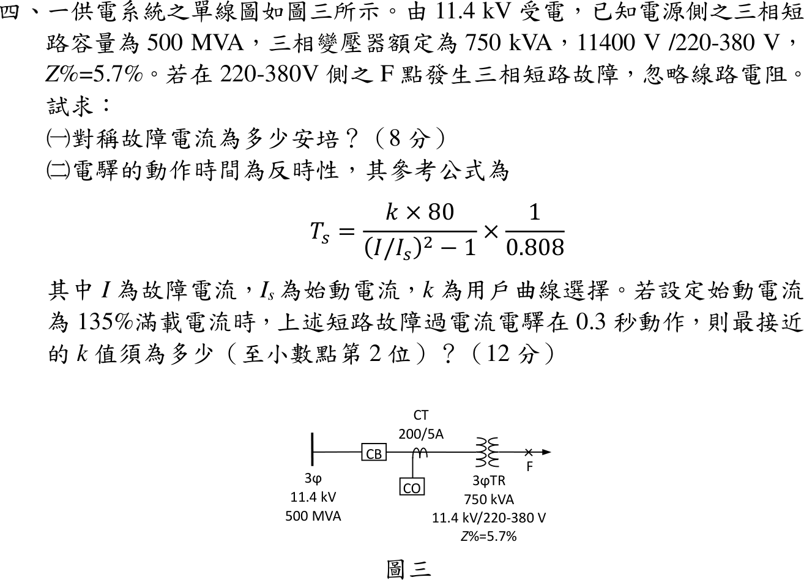

# 112 年工業配電第 4 題｜低壓側三相短路與反時性電驛

## 已知與所求

11.4 kV 受電，電源三相短路容量 \(500\,\mathrm{MVA}\)；變壓器 \(750\,\mathrm{kVA}\)、\(11400\,\mathrm V/220\text{-}380\,\mathrm V\)、\(Z\%=5.7\%\)；CT \(200/5\) 與 CO 電驛在高壓側；F 點在低壓側三相短路，忽略線路電阻。求（一）對稱故障電流（8 分）；（二）始動電流 \(135\%\) 滿載、\(0.3\,\mathrm s\) 動作時的 \(k\)（至小數第 2 位，12 分）。

### 官方題目公式

\[
T_s=\dfrac{k\times80}{(I/I_s)^2-1}\times\dfrac{1}{0.808}
\]

## 考場標準作答

### （一）對稱故障電流

標么法：以變壓器容量為基準，故障電抗 = 電源電抗 + 變壓器電抗，短路電流 = 基準電流 / 總電抗。畫法：電源（\(500\,\mathrm{MVA}\)）電抗串變壓器電抗，F 點在低壓側。取 \(S_b=750\,\mathrm{kVA}\)、低壓線電壓 \(380\,\mathrm V\)（220 V 為相電壓，不可當線電壓）（以下以完整精度計算，只顯示兩位小數）：
\[
X_{src}=\frac{0.75}{500}=1.50\times10^{-3}\,\mathrm{pu},\qquad X_T=5.7\%
\]
\[
X=X_{src}+X_T=1.50\times10^{-3}+5.7\%=5.85\times10^{-2}\,\mathrm{pu},\qquad I_b=\frac{750\,000}{\sqrt3(380)}=1139.51\,\mathrm A
\]
\[
I_F=\frac{I_b}{X}=\frac{1139.51}{5.85\times10^{-2}}=19\,478.75\,\mathrm A\approx\boxed{19.48\,\mathrm{kA}}
\]

### （二）\(k\) 值

反時性電驛公式中 \(I/I_s\) 須在同一電壓側比較；CT 與電驛在高壓側，故障電流與始動電流都換到 \(11.4\,\mathrm{kV}\) 側。故障電流依電壓比換算，始動電流取 \(135\%\) 高壓側滿載電流：
\[
I_{F,H}=19\,478.75\times\frac{380}{11\,400}=649.29\,\mathrm A,\qquad
I_{rated,H}=\frac{750\,000}{\sqrt3(11\,400)}=37.98\,\mathrm A,\qquad I_s=1.35(37.98)=51.28\,\mathrm A
\]
\[
\frac{I}{I_s}=\frac{649.29}{51.28}=12.66,\qquad \left(\frac{I}{I_s}\right)^2=160.33,\qquad \left(\frac{I}{I_s}\right)^2-1=159.33
\]
將 \(T_s=0.3\,\mathrm s\) 代入公式解 \(k\)：
\[
k=\frac{T_s\times0.808\times\left[(I/I_s)^2-1\right]}{80}=\frac{0.3\times0.808\times159.33}{80}=\frac{38.62}{80}=4.83\times10^{-1}\Rightarrow\boxed{0.48}
\]

## 驗算

歐姆法（380 V 側）：\(X_s=380^2/(500\times10^6)=2.89\times10^{-4}\,\Omega\)、\(X_T=5.7\%(380^2/750\,000)=1.10\times10^{-2}\,\Omega\)，\(X_s+X_T=1.13\times10^{-2}\,\Omega\)，\(I_F=380/[\sqrt3(1.13\times10^{-2})]=19.48\,\mathrm{kA}\)。比值與側別無關：\(I/I_s=1/(5.85\times10^{-2}\times1.35)=12.66\)，回代 \(T_s=0.48(80)/159.33/0.808=2.98\times10^{-1}\,\mathrm s\approx0.3\,\mathrm s\)。

## 失分點

- 用相電壓 220 V 計算三相故障電流（會放大 \(\sqrt3\) 倍）。
- 故障電流用低壓側、始動電流用高壓側，\(I/I_s\) 差 30 倍。
- 把 \(\times\dfrac{1}{0.808}\) 看成 \(\times0.808\)。
