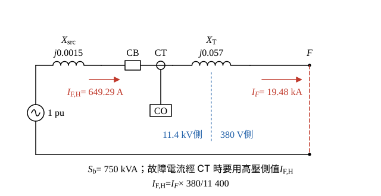

# 112 年工業配電第 4 題｜低壓側三相短路與反時性電驛

## 已知與所求

11.4 kV 受電，電源三相短路容量 \(500\,\mathrm{MVA}\)；變壓器 \(750\,\mathrm{kVA}\)、\(11400\,\mathrm V/220\text{-}380\,\mathrm V\)、\(Z\%=5.7\%\)；CT \(200/5\) 與 CO 電驛在高壓側；F 點在低壓側三相短路，忽略線路電阻。求（一）對稱故障電流（8 分）；（二）始動電流 \(135\%\) 滿載、\(0.3\,\mathrm s\) 動作時的 \(k\)（至小數第 2 位，12 分）。

### 官方題目公式

\[
T_s=\dfrac{k\times80}{(I/I_s)^2-1}\times\dfrac{1}{0.808}
\]

## 考場標準作答

**解題邏輯**：（一）用標么法：取 \(S_b=750\,\mathrm{kVA}\)，電源電抗由短路容量換算、再串變壓器電抗，故障電流 = 低壓側基準電流 ÷ 總電抗；低壓側線電壓取 380 V（220 V 是相電壓）。（二）CT 與 CO 電驛裝在 11.4 kV 側，故 \(I/I_s\) 必須在同一側比較：把故障電流依電壓比換到高壓側，始動電流取高壓側滿載電流的 135%，代入題目公式解 \(k\)。

### 步驟 1：標么電抗圖

- 電源以 \(1\,\mathrm{pu}\) 電壓源串 \(X_{src}\) 表示，經 CB、CT（高壓側）後串變壓器 \(X_T\) 到低壓側故障點 F，F 對參考點短路。
- 忽略線路電阻，全以電抗相加。

電源電抗（短路容量換算）：
\[
X_{src}=\frac{S_b}{S_{sc}}=\frac{0.75}{500}=0.0015\,\mathrm{pu}
\]
變壓器（額定即 750 kVA）：
\[
X_T=5.7\%=0.057\,\mathrm{pu}
\]
\[
X=X_{src}+X_T=0.0015+0.057=0.0585\,\mathrm{pu}
\]

### （一）對稱故障電流（8 分）

**邏輯**：三相故障、故障前電壓取 \(1\,\mathrm{pu}\)，\(I_F=I_b/X\)；F 在 380 V 側，基準電流用 380 V 線電壓計算。

\[
I_b=\frac{S_b}{\sqrt3V_b}=\frac{750\,000}{\sqrt3\times380}=\frac{750\,000}{658.179}=1139.51\,\mathrm A
\]
\[
I_F=\frac{I_b}{X}=\frac{1139.51}{0.0585}=19\,478.75\,\mathrm A
\]
\[
\boxed{I_F=19.48\,\mathrm{kA}}
\]

### （二）\(k\) 值（12 分）

**邏輯**：電驛看到的是高壓側 CT 電流，\(I\) 與 \(I_s\) 都要用 11.4 kV 側值；把 \(T_s=0.3\,\mathrm s\) 與 \((I/I_s)^2-1\) 代入題目公式反解 \(k\)。

故障電流換到高壓側（電流與電壓比成反比）：
\[
I_{F,H}=I_F\times\frac{380}{11\,400}=\frac{19\,478.75}{30}=649.29\,\mathrm A
\]
高壓側滿載電流與始動電流：
\[
I_{rated,H}=\frac{750\,000}{\sqrt3\times11\,400}=\frac{750\,000}{19\,745.38}=37.984\,\mathrm A
\]
\[
I_s=1.35\times37.984=51.278\,\mathrm A
\]
倍數與公式中的分母：
\[
\frac{I}{I_s}=\frac{649.29}{51.278}=12.662
\]
\[
\left(\frac{I}{I_s}\right)^2=12.662^2=160.33
\]
\[
\left(\frac{I}{I_s}\right)^2-1=159.33
\]
由 \(T_s=\dfrac{k\times80}{(I/I_s)^2-1}\times\dfrac{1}{0.808}\) 移項：
\[
k=\frac{T_s\times0.808\times\left[(I/I_s)^2-1\right]}{80}
\]
\[
k=\frac{0.3\times0.808\times159.33}{80}=\frac{0.2424\times159.33}{80}=\frac{38.622}{80}=0.4828
\]
\[
\boxed{0.48}
\]

## 驗算

歐姆法（380 V 側）：\(X_s=380^2/(500\times10^6)=2.888\times10^{-4}\,\Omega\)、\(X_T=0.057\times380^2/750\,000=0.010974\,\Omega\)，和 \(=0.011263\,\Omega\)，\(I_F=380/(\sqrt3\times0.011263)=380/0.019508=19\,479\,\mathrm A\approx19.48\,\mathrm{kA}\)。比值與側別無關：\(I/I_s=1/(0.0585\times1.35)=1/0.078975=12.662\)；回代 \(k=0.48\)：\(T_s=\dfrac{0.48\times80}{159.33}\times\dfrac{1}{0.808}=\dfrac{38.4}{159.33}\times\dfrac{1}{0.808}=0.24101\times1.2376=0.2983\,\mathrm s\approx0.3\,\mathrm s\)。

## 失分點

- 用相電壓 220 V 計算三相故障電流（會放大 \(\sqrt3\) 倍）。
- 故障電流用低壓側、始動電流用高壓側，\(I/I_s\) 差 30 倍。
- 把 \(\times\dfrac{1}{0.808}\) 看成 \(\times0.808\)。
