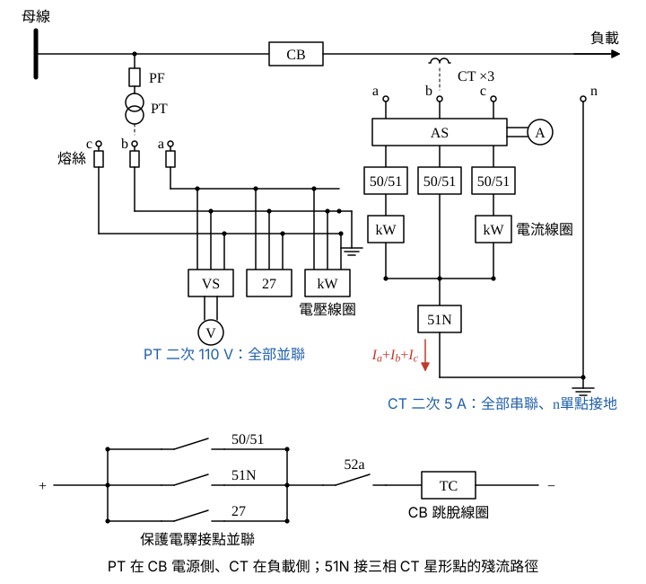

# 112 年工業配電第 5 題｜高壓受電保護與計量接線

## 已知與所求

圖四：母線—虛線區—CB—虛線區—負載。在虛線範圍加入 50/51、51N、CT、PT、AS、VS、V、A、27、kW，繪出合理接線（20 分）。

## 考場標準作答

### 合理接線（20 分）

設三相三線受電，CT 二次 5 A 三只接 Y，PT 二次 110 V 採 V-V 接線。PT 放在 CB 電源側，CB 跳脫後仍能監視電源電壓並供 27 判斷；CT 放在 CB 負載側，使 CB 以下線路落在保護區內。CT 二次為電流源，電流元件全部串聯；PT 二次為電壓源，電壓元件全部並聯；kW 表三相三線用兩瓦特計法，只取 a、c 相電流與 \(V_{ab}\)、\(V_{cb}\)。

1. 一次側配置（圖 1 上方）：母線 → PT（經電力熔絲 PF 接在 CB 電源側）→ CB → CT ×3（CB 負載側）→ 負載。
2. CT 二次（電流迴路，全部串聯）：
   - a、b、c 三線依序穿過 AS（電流切換開關，接 A 表）、各相 50/51、kW 電流線圈（只在 a、c 相）；
   - 三線在電驛後方接成星形點，星形點經 51N 回到 CT 共點 n，51N 流過殘流 \(I_a+I_b+I_c=3I_0\)；
   - n 單點接地；AS 切換時須先短路被切離的 CT，不得開路。
3. PT 二次（電壓迴路，全部並聯）：
   - a、b、c 三線各經熔絲成 110 V 三線母線，b 線單點接地；
   - VS（電壓切換開關，選 \(V_{ab}\)、\(V_{bc}\)、\(V_{ca}\)）接 V 表、27、kW 電壓線圈（\(V_{ab}\)、\(V_{cb}\)）都跨接在這三線上。
4. 跳脫迴路：50/51、51N、27 的動作接點並聯，串 CB 輔助接點 52a 與跳脫線圈 TC，接到直流控制電源。

\[
\boxed{\text{PT 在 CB 電源側、CT 在負載側；CT 二次串接 A、50/51、51N（殘流）、kW；PT 二次並接 V（經 VS）、27、kW}}
\]

## 驗算

兩瓦特計檢查：\(P=V_{ab}I_a\cos(30^\circ+\phi)+V_{cb}I_c\cos(30^\circ-\phi)=\sqrt3V_LI_L\cos\phi\)，確認 kW 表取 a、c 相電流與 \(V_{ab}\)、\(V_{cb}\) 的接法正確。51N 正常時 \(I_a+I_b+I_c=0\) 不動作，接地故障時殘流 \(3I_0\) 流入，動作邏輯正確。

## 失分點

- CT 二次開路（AS 切換或抽換儀表時），會產生高壓危險；須用短路片。
- 把 V、27 串聯接在 PT 二次；電壓元件必須並聯。
- 51N 接在單相 CT 上；應接殘流路徑或零序 CT。
