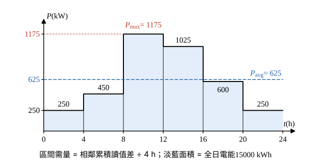

# 113 年工業配電第 1 題｜日負載曲線與主變壓器容量

## 已知與所求

圖為 A、B、C 三分廠電錶的累積用電量（度）曲線，0–24 h 每 4 h 一點；總和 PF \(0.94\) 落後。求（一）主變壓器最小容量 kVA；（二）總和日負載因數。

| 時間（h） | 0 | 4 | 8 | 12 | 16 | 20 | 24 |
|---|---:|---:|---:|---:|---:|---:|---:|
| A 廠 | 0 | 400 | 1000 | 2500 | 3600 | 4200 | 4600 |
| B 廠 | 0 | 200 | 600 | 1400 | 2400 | 3000 | 3200 |
| C 廠 | 0 | 400 | 1200 | 3600 | 5600 | 6800 | 7200 |
| 合計 | 0 | 1000 | 2800 | 7500 | 11600 | 14000 | 15000 |

## 考場標準作答

**解題邏輯**：圖的縱軸是電錶**累積**用電量（度 = kWh），不是瞬時需量；相鄰兩點讀值相減得該 4 h 區間的電能，除以 4 h 得區間平均需量。三分廠共用一台主變，所以要先把三廠同一區間的電能相加成總和需量，再找最大值（不是各廠最大值相加）。（一）主變容量 = 最大總和需量 ÷ PF；（二）負載因數 = 全日平均需量 ÷ 最大需量。

### 步驟 1：各區間總和電能與需量

區間需量公式：
\[
P_k=\frac{E(t_k)-E(t_{k-1})}{4\,\mathrm h}
\]
先把三廠讀值相加成合計累積讀值（已知表最後一列）：0、1000、2800、7500、11600、14000、15000 kWh。相鄰相減再除以 4：

| 區間（h） | 0–4 | 4–8 | 8–12 | 12–16 | 16–20 | 20–24 |
|---|---:|---:|---:|---:|---:|---:|
| 增量計算（kWh） | 1000−0 | 2800−1000 | 7500−2800 | 11600−7500 | 14000−11600 | 15000−14000 |
| 增量（kWh） | 1000 | 1800 | 4700 | 4100 | 2400 | 1000 |
| 需量 \(=\) 增量 ÷ 4（kW） | 250 | 450 | 1175 | 1025 | 600 | 250 |

### （一）主變壓器最小容量（10 分）

**邏輯**：主變要供應全廠同時發生的最大總和需量；kW 除以總和功率因數得 kVA。

最大總和需量出現在 8–12 h：
\[
P_{\max}=\frac{7500-2800}{4}=\frac{4700}{4}=1175\,\mathrm{kW}
\]
\[
S_{\min}=\frac{P_{\max}}{\mathrm{PF}}=\frac{1175}{0.94}=1250\,\mathrm{kVA}
\]
\[
\boxed{S_{\min}=1250\,\mathrm{kVA}}
\]

### （二）總和日負載因數（10 分）

**邏輯**：負載因數 = 平均需量 ÷ 最大需量；平均需量 = 全日總電能 ÷ 24 h，最大需量沿用（一）的 \(1175\,\mathrm{kW}\)。

\[
\mathrm{LF}=\frac{P_{avg}}{P_{\max}}=\frac{E_{total}/24}{P_{\max}}
\]
全日總電能（24 h 累積讀值相加）：
\[
E_{total}=4600+3200+7200=15000\,\mathrm{kWh}
\]
\[
P_{avg}=\frac{15000}{24}=625\,\mathrm{kW}
\]
\[
\mathrm{LF}=\frac{625}{1175}=0.531915
\]
\[
\boxed{\mathrm{LF}=53.19\%}
\]

## 驗算

各廠全日用電 \(4600+3200+7200=15000\,\mathrm{kWh}\)，等於六區間增量和 \(1000+1800+4700+4100+2400+1000=15000\)。8–12 h 分廠增量 \(1500+800+2400=4700\,\mathrm{kWh}\)，確為最大區間。

## 失分點

- 把累積讀值（如 24 h 的 7200）當瞬時 kW。
- 各廠個別最大需量相加（\(375+250+600=1225\,\mathrm{kW}\)）不是總和需量；B 廠最大在 12–16 h，與 A、C 不同時。
- 8 h 讀值為 A 1000、B 600、C 1200（合計 2800）；讀錯會使 8–12 h 增量偏離 4700。
