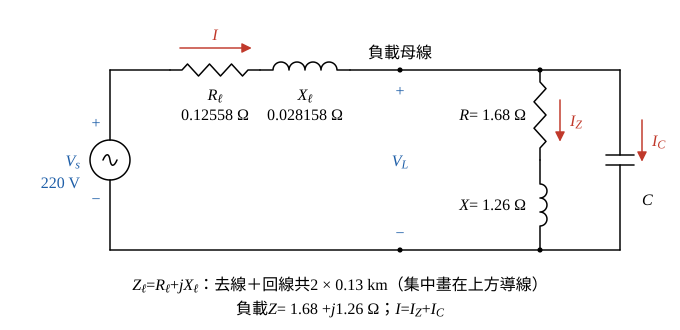

# 113 年工業配電第 2 題｜單相線路壓降與功率因數校正

## 已知與所求

單相兩線負載 \(Z=1.68+j1.26\,\Omega\)，電源固定 \(220\,\mathrm V\)、\(60\,\mathrm{Hz}\)；電纜長 \(130\,\mathrm m\)，\(0.483+j0.1083\,\Omega/\mathrm{km}\)；並聯電容校正功率因數。負載電壓降百分率容許 \(5\%\)，求至少需校正到的功率因數（計算至小數第 4 位）。

## 考場標準作答

**解題邏輯**：題目要求「負載電壓降百分率 \(\le5\%\)」時的最低功率因數，用線路壓降近似式 \(\Delta V\approx I(R_\ell\cos\phi+X_\ell\sin\phi)\) 反推 \(\tan\phi\)。並聯電容只提供無效電流、不吸收實功率，所以線路電流的有效分量 \(I\cos\phi\) 等於負載電流的有效分量，可由負載電壓與定阻抗負載直接算出；依序求來回線路阻抗 → 負載電壓下限與容許壓降 → \(I\cos\phi\) → \(\tan\phi\) → \(\mathrm{PF}\)。前提：負載為定阻抗 \(Z\)，電源電壓固定 \(220\,\mathrm V\)，電容器為理想（無損失）；近似式忽略壓降的垂直分量，驗算段以精確相量解核對。題幹要求計算至小數第 4 位，以下顯示到小數第 4 位（題給數據相乘得到的精確值照實寫）。

### 步驟 1：等效電路與來回線路阻抗

- 電源 \(V_s=220\,\mathrm V\) 經單相兩線電纜（去線＋回線）接到負載母線，母線電壓 \(V_L\)。
- 母線上並聯定阻抗負載 \(Z\) 與校正電容器 \(C\)；線路電流 \(I=I_Z+I_C\)（參考方向：\(I\) 由電源流向母線，\(I_Z\)、\(I_C\) 由母線流向回線），\(\phi\) 為 \(V_L\) 超前 \(I\) 的角度（校正後的功率因數角）。

單相兩線的電流去回都經過電纜，阻抗按 2 倍長度計，\(130\,\mathrm m=0.13\,\mathrm{km}\)：
\[
Z_\ell=2\,\ell\,z=2(0.13)(0.483+j0.1083)
\]
\[
Z_\ell=0.26(0.483+j0.1083)=0.12558+j0.028158\,\Omega
\]
即 \(R_\ell=0.12558\,\Omega\)、\(X_\ell=0.028158\,\Omega\)（精確值）。

### 步驟 2：未校正時的壓降（確認必須校正）

未裝電容時線路與負載串聯，負載電壓由分壓求得。負載阻抗大小：
\[
|Z|=\sqrt{1.68^2+1.26^2}=\sqrt{2.8224+1.5876}=\sqrt{4.41}=2.1\,\Omega
\]
總阻抗：
\[
Z+Z_\ell=(1.68+0.12558)+j(1.26+0.028158)=1.80558+j1.288158\,\Omega
\]
\[
|Z+Z_\ell|=\sqrt{1.80558^2+1.288158^2}=\sqrt{3.2601+1.6594}=\sqrt{4.9195}=2.2180\,\Omega
\]
\[
V_L=V_s\frac{|Z|}{|Z+Z_\ell|}=\frac{220(2.1)}{2.2180}=\frac{462}{2.2180}=208.2958\,\mathrm V
\]
\[
\frac{V_s-V_L}{V_L}=\frac{220-208.2958}{208.2958}=\frac{11.7042}{208.2958}=0.0562=5.62\%>5\%
\]
超過容許值，須並聯電容提高功率因數。

### 步驟 3：負載電壓下限與容許壓降

壓降百分率以負載電壓為分母：
\[
\frac{V_s-V_L}{V_L}\le0.05\ \Rightarrow\ V_L\ge\frac{V_s}{1.05}=\frac{220}{1.05}=209.5238\,\mathrm V
\]
\[
\Delta V=V_s-V_L\le220-209.5238=10.4762\,\mathrm V
\]
在臨界點 \(\Delta V=0.05V_L\)。

### 步驟 4：線路電流的有效分量 \(I\cos\phi\)

電容電流超前 \(V_L\) 恰 \(90^\circ\)，對有效分量沒有貢獻，故線路電流的有效分量＝負載電流的有效分量。在 \(V_L=209.5238\,\mathrm V\) 時：
\[
I_Z=\frac{V_L}{|Z|}=\frac{209.5238}{2.1}=99.7732\,\mathrm A,\qquad
\cos\phi_Z=\frac{R}{|Z|}=\frac{1.68}{2.1}=0.8
\]
\[
I\cos\phi=I_Z\cos\phi_Z=99.7732(0.8)=79.8186\,\mathrm A
\]

### 最低功率因數（20 分）

**邏輯**：把近似式寫成 \(\Delta V\approx I\cos\phi\,(R_\ell+X_\ell\tan\phi)\)，其中 \(\Delta V\) 與 \(I\cos\phi\) 已由步驟 3、4 求出，只剩 \(\tan\phi\) 未知；功因愈高 \(\tan\phi\) 愈小、壓降愈小，故臨界點的 \(\tan\phi\) 即對應最低功率因數。

近似壓降式提出 \(I\cos\phi\)：
\[
\Delta V\approx I(R_\ell\cos\phi+X_\ell\sin\phi)=I\cos\phi\,(R_\ell+X_\ell\tan\phi)
\]
移項：
\[
\tan\phi=\frac{\Delta V/(I\cos\phi)-R_\ell}{X_\ell}
\]
先求比值。臨界點 \(\Delta V=0.05V_L\)、\(I\cos\phi=V_LR/|Z|^2\)，\(V_L\) 約去，比值為精確值（不可用四捨五入後的 \(10.4762/79.8186\) 再取 4 位，因為下一行與 \(R_\ell\) 相減會把誤差放大）：
\[
\frac{\Delta V}{I\cos\phi}=\frac{0.05V_L}{V_LR/|Z|^2}=\frac{0.05|Z|^2}{R}=\frac{0.05(4.41)}{1.68}=\frac{0.2205}{1.68}=0.13125\,\Omega
\]
代入 \(\tan\phi\)：
\[
\tan\phi=\frac{0.13125-0.12558}{0.028158}=\frac{0.00567}{0.028158}=0.2014
\]
換成功率因數：
\[
\mathrm{PF}=\cos\phi=\frac{1}{\sqrt{1+\tan^2\phi}}=\frac{1}{\sqrt{1+0.2014^2}}=\frac{1}{\sqrt{1.0406}}=\frac{1}{1.0201}
\]
\[
\boxed{\mathrm{PF}_{\min}=0.9803\text{（落後）}}
\]
題幹要求計算至小數第 4 位，故答案取 0.9803（落後）；功因再高壓降更小，故「至少」校正到 0.9803。

## 驗算

精確相量解：令電容電納 \(B\)，\(Z_{eq}=1/(1/Z+jB)\)，\(V_L=220\,|Z_{eq}/(Z_\ell+Z_{eq})|\)。以二分法解 \(V_L=209.5238\,\mathrm V\) 得 \(B=0.2090\,\mathrm S\)（\(Q_C=BV_L^2=9.18\,\mathrm{kvar}\)），此時 \(Z_{eq}\) 的功率因數為 \(0.9803\)，與近似式一致。

## 失分點

- 線長 130 m 未乘 2；單相兩線來回皆有阻抗。另 \(\Delta V/(I\cos\phi)=0.131250\) 與 \(R_\ell\) 幾乎相消，\(Z_\ell\) 若捨入成 \(0.1256+j0.0282\) 會得 PF \(0.9805\)，須保留 \(0.12558+j0.028158\)。
- 負載為定阻抗，\(P\) 須用校正後負載電壓 \(209.5238\,\mathrm V\) 計算，不能直接用 \(220\,\mathrm V\) 而不同時調整 \(\Delta V\) 的基準。
- 若把壓降百分率改以電源電壓為分母（\(V_L\ge209\,\mathrm V\)），精確解 PF 約 \(0.9147\)；本題「負載電壓降百分率」以負載端電壓為分母。
