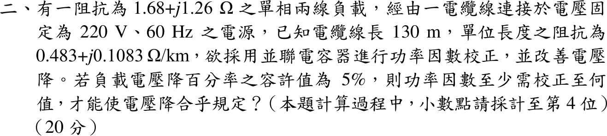

# 113 年工業配電第 2 題｜單相線路壓降與功率因數校正

## 已知與所求

單相兩線負載 \(Z=1.68+j1.26\,\Omega\)，電源固定 \(220\,\mathrm V\)、\(60\,\mathrm{Hz}\)；電纜長 \(130\,\mathrm m\)，\(0.483+j0.1083\,\Omega/\mathrm{km}\)；並聯電容校正功率因數。負載電壓降百分率容許 \(5\%\)，求至少需校正到的功率因數（計算至小數第 4 位）。

## 考場標準作答

線路壓降近似：\(\Delta V\approx I(R_\ell\cos\phi+X_\ell\sin\phi)\)，並聯電容只降低負載端電流的無效分量、不吸收實功率，故可用負載實功率不變來反推所需功因。等效電路畫法：電源 \(220\,\mathrm V\) 經來回線路阻抗 \(Z_\ell\) 接到負載母線，母線上並聯負載 \(Z\) 與電容器（以下以完整精度計算，只顯示兩位小數）。

來回線路阻抗（單相兩線，長度乘 2；\(130\,\mathrm m=0.13\,\mathrm{km}\)）：
\[
Z_\ell=2(0.13)(0.483+j0.1083)=1.26\times10^{-1}+j2.82\times10^{-2}\,\Omega
\]
先檢查未校正時是否超標：
\[
I=\frac{220}{|Z+Z_\ell|}=\frac{220}{|1.81+j1.29|}=99.19\,\mathrm A,\qquad V_L=I|Z|=99.19(2.10)=208.30\,\mathrm V
\]
\[
\frac{220-208.30}{208.30}=5.62\%>5\%
\]

壓降百分率以負載電壓為分母，故負載電壓下限與容許壓降為：
\[
V_L\ge\frac{220}{1.05}=209.52\,\mathrm V,\qquad \Delta V\le220-209.52=10.48\,\mathrm V
\]
負載為定阻抗，電容不吸收實功率，故在 \(V_L=209.52\,\mathrm V\) 時負載實功率與電流實部為
\[
P=\frac{V_L^2R}{|Z|^2}=\frac{209.52^2(1.68)}{4.41}=16\,723.90\,\mathrm W,\qquad I\cos\phi=\frac{P}{V_L}=\frac{16\,723.90}{209.52}=79.82\,\mathrm A
\]
由 \(\Delta V\approx I\cos\phi\,(R_\ell+X_\ell\tan\phi)\) 解 \(\tan\phi\)：
\[
\frac{\Delta V}{I\cos\phi}=\frac{10.48}{79.82}=1.31\times10^{-1},\qquad
\tan\phi=\frac{1.31\times10^{-1}-1.26\times10^{-1}}{2.82\times10^{-2}}=\frac{5.67\times10^{-3}}{2.82\times10^{-2}}=2.01\times10^{-1}
\]
\[
\boxed{\mathrm{PF}_{\min}=\frac1{\sqrt{1+\tan^2\phi}}=\frac1{\sqrt{1+(2.01\times10^{-1})^2}}=0.9803\text{ 落後}}
\]
題幹要求計算至小數第 4 位，故答案取 0.9803（落後）；此為完整精度計算後再四捨五入，中間值的兩位小數僅為顯示。

## 驗算

精確相量解：令電容電納 \(B\)，\(Z_{eq}=1/(Y_L+jB)\)，\(V_L=220\,|Z_{eq}/(Z_\ell+Z_{eq})|\)。二分法解 \(V_L=209.52\,\mathrm V\) 得 \(B=2.09\times10^{-1}\,\mathrm S\)（\(Q_c=9.18\,\mathrm{kvar}\)），\(Z_{eq}\) 的功率因數 \(0.9803\)，與近似式一致。

## 失分點

- 線長 130 m 未乘 2；單相兩線來回皆有阻抗。另 \(\Delta V/(I\cos\phi)=0.131250\) 與 \(R_\ell\) 幾乎相消，\(Z_\ell\) 若捨入成 \(0.1256+j0.0282\) 會得 PF \(0.9805\)，須保留 \(0.12558+j0.028158\)。
- 負載為定阻抗，\(P\) 須用校正後負載電壓 \(209.5238\,\mathrm V\) 計算，不能直接用 \(220\,\mathrm V\) 而不同時調整 \(\Delta V\) 的基準。
- 若把壓降百分率改以電源電壓為分母（\(V_L\ge209\,\mathrm V\)），精確解 PF 約 \(0.9147\)；本題「負載電壓降百分率」以負載端電壓為分母。
