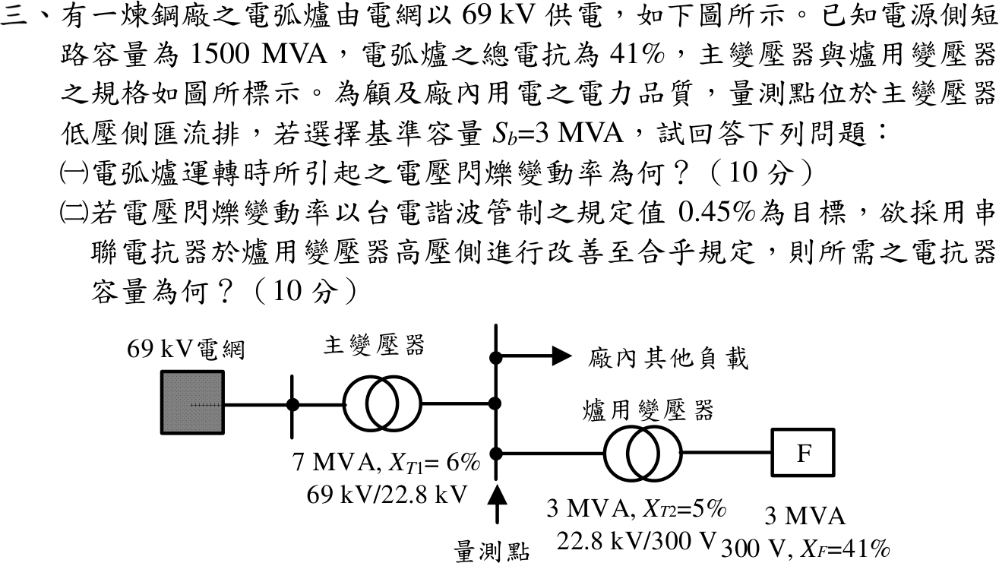
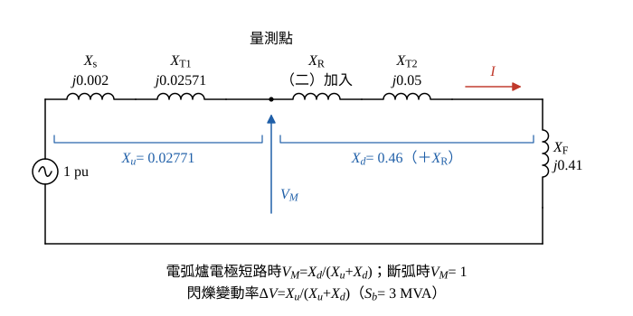

# 113 年工業配電第 3 題｜電弧爐電壓閃爍與串聯電抗器

## 已知與所求

69 kV 電網短路容量 \(1500\,\mathrm{MVA}\)；主變 \(7\,\mathrm{MVA}\)、\(X_{T1}=6\%\)、\(69/22.8\,\mathrm{kV}\)；爐用變壓器 \(3\,\mathrm{MVA}\)、\(X_{T2}=5\%\)、\(22.8\,\mathrm{kV}/300\,\mathrm V\)；電弧爐 \(3\,\mathrm{MVA}\)、\(X_F=41\%\)；量測點在主變低壓側匯流排；\(S_b=3\,\mathrm{MVA}\)。求（一）電壓閃爍變動率；（二）以 \(0.45\%\) 為目標，在爐變高壓側加串聯電抗器所需容量。

## 考場標準作答

**解題邏輯**：以標么電壓分壓求閃爍：斷弧時量測點電壓 \(1\,\mathrm{pu}\)，電弧爐電極短路時量測點電壓被上游、下游電抗分壓，兩者之差就是電壓閃爍變動率。量測點在主變低壓側匯流排，所以電網與主變串成「上游」\(X_u\)，爐用變壓器與電弧爐串成「下游」\(X_d\)。依序求各電抗 → \(X_u\)、\(X_d\) → （一）\(\Delta V=X_u/(X_u+X_d)\) → （二）把串聯電抗器 \(X_R\) 加進下游、令 \(\Delta V=0.45\%\) 解出 \(X_R\)，再換成容量。

### 步驟 1：各電抗換到 \(S_b=3\,\mathrm{MVA}\)

電網以短路容量換算：
\[
X_s=\frac{S_b}{S_{sc}}=\frac{3}{1500}=0.002\,\mathrm{pu}
\]
主變（7 MVA）：
\[
X_{T1}=0.06\times\frac{3}{7}=\frac{0.18}{7}=0.02571\,\mathrm{pu}
\]
爐用變壓器與電弧爐額定即 3 MVA：
\[
X_{T2}=0.05\,\mathrm{pu},\qquad X_F=0.41\,\mathrm{pu}
\]

### 步驟 2：上游、下游電抗

- 標么電壓源 \(1\,\mathrm{pu}\) 串 \(X_s\)、\(X_{T1}\) 到量測點母線（上游 \(X_u\)）。
- 量測點母線經（二）才加入的 \(X_R\)、\(X_{T2}\)、\(X_F\) 到參考點（下游 \(X_d\)；電弧爐電極短路時 \(X_F\) 即接地）。
- 量測點電壓 \(V_M\) 量在量測點母線與參考線之間。
- 圖中「廠內其他負載」不列入分壓：閃爍是電弧爐電流的「變動量」在上游電抗造成的電壓變動，依疊加原理只由爐支路的電流增量決定；其他負載電流不隨電弧變動，只影響穩態電壓。

\[
X_u=X_s+X_{T1}=0.002+0.02571=0.02771\,\mathrm{pu}
\]
\[
X_d=X_{T2}+X_F=0.05+0.41=0.46\,\mathrm{pu}
\]
\[
X_u+X_d=0.02771+0.46=0.4877\,\mathrm{pu}
\]

### （一）電弧爐運轉時的電壓閃爍變動率（10 分）

**邏輯**：斷弧時量測點電壓 \(1\,\mathrm{pu}\)；電極短路時量測點電壓 \(=X_d/(X_u+X_d)\)，兩者之差等於上游分壓 \(X_u/(X_u+X_d)\)。

\[
\Delta V=1-\frac{X_d}{X_u+X_d}=\frac{X_u}{X_u+X_d}
\]
\[
\Delta V=\frac{0.02771}{0.4877}=0.05682
\]
\[
\boxed{\Delta V=5.68\%}
\]

### （二）串聯電抗器所需容量（10 分）

**邏輯**：電抗器串在爐用變壓器高壓側，屬於量測點下游，使分母增為 \(X_u+X_d+X_R\)；令變動率 \(=0.45\%=0.0045\) 解 \(X_R\)，再以 \(3\,\mathrm{MVA}\) 基準電流（爐用變壓器額定電流）標示容量。

\[
0.0045=\frac{X_u}{X_u+X_d+X_R}
\]
\[
X_u+X_d+X_R=\frac{X_u}{0.0045}=\frac{0.02771}{0.0045}=6.158\,\mathrm{pu}
\]
\[
X_R=6.158-0.4877=5.670\,\mathrm{pu}
\]
\[
\boxed{X_R=5.67\,\mathrm{pu}}
\]
電抗器在基準電流下的容量（\(Q=I^2X\)，以標么表示即 \(X_R\times S_b\)）：
\[
Q_R=X_R\times S_b=5.670\times3=17.01\,\mathrm{MVA}
\]
\[
\boxed{Q_R=17.01\,\mathrm{MVA}}
\]
歐姆值（22.8 kV 側，\(Z_b=V_b^2/S_b\)）：
\[
Z_b=\frac{22.8^2}{3}=\frac{519.84}{3}=173.28\,\Omega
\]
\[
X_R=5.670\times173.28=982.5\,\Omega
\]

## 驗算

加入 \(X_R\) 後電極短路電流 \(I=1/6.158=0.1624\,\mathrm{pu}\)，量測點電壓變動 \(IX_u=0.1624\times0.02771=0.004500\)，即 \(0.45\%\)。

## 失分點

- 爐用變壓器算入量測點上游，分子錯誤。
- \(0.45\%\) 代成 \(0.045\) 或 \(0.45\)。
- 只寫 pu 值而未換成容量或歐姆值。

## 條件與疑義

「電抗器容量」依慣例以額定電流（此處等於 3 MVA 基準電流）下的 \(I^2X\) 標示為 \(17.01\,\mathrm{MVA}\)；若指改善後實際電弧短路時的無效功率，則為 \(I^2X_RS_b=0.1624^2\times5.670\times3=0.02637\times17.01=0.45\,\mathrm{Mvar}\)。
