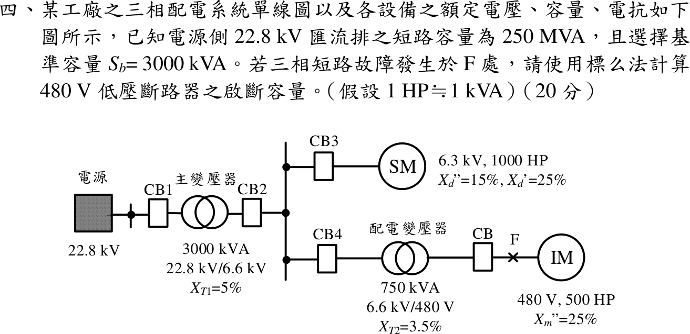
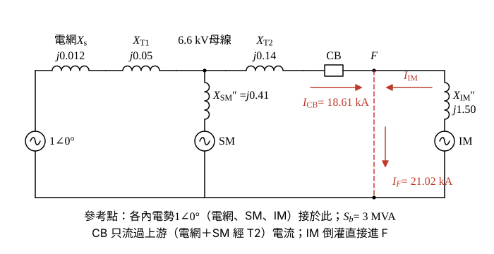

# 113 年工業配電第 4 題｜480 V 斷路器啟斷容量

## 已知與所求

22.8 kV 匯流排短路容量 \(250\,\mathrm{MVA}\)；主變 \(3000\,\mathrm{kVA}\)、\(22.8/6.6\,\mathrm{kV}\)、\(X_{T1}=5\%\)；6.6 kV 母線接同步馬達 \(6.3\,\mathrm{kV}\)、\(1000\,\mathrm{HP}\)、\(X_d''=15\%\)、\(X_d'=25\%\)，及配電變壓器 \(750\,\mathrm{kVA}\)、\(6.6\,\mathrm{kV}/480\,\mathrm V\)、\(X_{T2}=3.5\%\)；其後 CB—F—感應馬達 \(480\,\mathrm V\)、\(500\,\mathrm{HP}\)、\(X_m''=25\%\)；\(1\,\mathrm{HP}\approx1\,\mathrm{kVA}\)，\(S_b=3000\,\mathrm{kVA}\)。求 480 V 斷路器啟斷容量。

以下為初始對稱次暫態條件解（各內電勢 \(1\angle0^\circ\)、忽略電阻），見「條件與疑義」。

## 考場標準作答

**解題邏輯**：標么法求短路容量：所有電源與變壓器換成 \(S_b=3\,\mathrm{MVA}\) 基準的電抗，各內電勢取 \(1\angle0^\circ\)（初始對稱次暫態、忽略電阻）。F 點的短路電流由兩路匯入：上游（電網＋T1 與同步馬達並聯，再串 T2）經 CB 流入，以及感應馬達直接倒灌。依序求各元件電抗 → 上游等效電抗 \(X_u\) → CB 支路容量與電流 → 加上馬達倒灌得 F 點總量，最後說明 CB 選用哪一個值。

### 步驟 1：各元件換到 \(S_b=3\,\mathrm{MVA}\)

換基準公式：\(X_{new}=X_{old}\dfrac{S_b}{S_{rated}}\left(\dfrac{V_{rated}}{V_b}\right)^2\)；電網以短路容量換算 \(X_s=S_b/S_{sc}\)。

電網：
\[
X_s=\frac{S_b}{S_{sc}}=\frac{3}{250}=0.012\,\mathrm{pu}
\]
主變 T1（額定即 3 MVA）：
\[
X_{T1}=0.05\,\mathrm{pu}
\]
同步馬達（\(1000\,\mathrm{HP}\approx1\,\mathrm{MVA}\)，額定 6.3 kV、基準 6.6 kV）：
\[
\left(\frac{6.3}{6.6}\right)^2=0.954545^2=0.911157
\]
\[
X_{SM}''=0.15\times\frac{3}{1}\times0.911157=0.45\times0.911157=0.4100\,\mathrm{pu}
\]
配電變壓器 T2：
\[
X_{T2}=0.035\times\frac{3}{0.75}=0.035\times4=0.14\,\mathrm{pu}
\]
感應馬達（\(500\,\mathrm{HP}\approx0.5\,\mathrm{MVA}\)）：
\[
X_{IM}''=0.25\times\frac{3}{0.5}=0.25\times6=1.50\,\mathrm{pu}
\]

### 步驟 2：電抗圖與上游等效電抗

- 電網 \(1\angle0^\circ\) 串 \(X_s\)、\(X_{T1}\) 接 6.6 kV 母線；同步馬達 \(1\angle0^\circ\) 串 \(X_{SM}''\) 也接 6.6 kV 母線（兩者並聯）。
- 母線經 \(X_{T2}\) 與 CB 到 F；感應馬達 \(1\angle0^\circ\) 串 \(X_{IM}''\) 接在 F 的另一側。
- F 對參考點短路：CB 只流過上游電流 \(I_{CB}\)，感應馬達電流 \(I_{IM}\) 直接進 F。

電網＋T1 串聯：
\[
X_s+X_{T1}=0.012+0.05=0.062\,\mathrm{pu}
\]
與同步馬達並聯：
\[
(X_s+X_{T1})\parallel X_{SM}''=\frac{0.062\times0.4100}{0.062+0.4100}=\frac{0.025421}{0.472021}=0.053856\,\mathrm{pu}
\]
再串 T2：
\[
X_u=0.053856+0.14=0.19386\,\mathrm{pu}
\]

### 步驟 3：低壓側基準電流

\[
I_b=\frac{S_b}{\sqrt3V_b}=\frac{3\times10^6}{\sqrt3\times480}=\frac{3\times10^6}{831.384}=3608.44\,\mathrm A
\]

### 480 V 斷路器啟斷容量（20 分）

**邏輯**：依圖 CB 位於 T2 與 F 之間，流經 CB 的是上游電流 \(1/X_u\)；感應馬達倒灌直接注入 F，不經此 CB。短路容量 = 標么電流 × \(S_b\)，電流 = 標么電流 × \(I_b\)。

CB 支路標么電流：
\[
I_{CB,pu}=\frac{1}{X_u}=\frac{1}{0.19386}=5.1584\,\mathrm{pu}
\]
CB 支路短路容量：
\[
S_{CB}=I_{CB,pu}\times S_b=5.1584\times3=15.475\,\mathrm{MVA}
\]
\[
\boxed{S_{\mathrm{CB}}=15.48\,\mathrm{MVA}}
\]
CB 支路電流：
\[
I_{CB}=I_{CB,pu}\times I_b=5.1584\times3608.44=18\,614\,\mathrm A
\]
\[
\boxed{I_{\mathrm{CB}}=18.61\,\mathrm{kA}}
\]

感應馬達倒灌（只進 F，不經 CB）：
\[
S_{IM}=\frac{S_b}{X_{IM}''}=\frac{3}{1.50}=2.00\,\mathrm{MVA}
\]
\[
I_{IM}=\frac{I_b}{X_{IM}''}=\frac{3608.44}{1.50}=2405.63\,\mathrm A=2.41\,\mathrm{kA}
\]
F 點總量（兩支路內電勢同相、純電抗，大小直接相加）：
\[
\boxed{S_F=15.48+2=17.48\,\mathrm{MVA}},\qquad \boxed{I_F=18.61+2.41=21.02\,\mathrm{kA}}
\]

依圖 CB 位於 \(T_2\) 與 F 之間，馬達倒灌不流經此 CB，CB 實際啟斷的是 \(15.48\,\mathrm{MVA}\)（\(18.61\,\mathrm{kA}\)）；若依慣例取斷路器任一側故障的最大值選額定，則以 F 點總量 \(17.48\,\mathrm{MVA}\) 選用。

## 驗算

節點法：6.6 kV 母線電壓
\[
V_1=\frac{\frac{1}{0.062}+\frac{1}{0.4100}}{\frac{1}{0.062}+\frac{1}{0.4100}+\frac{1}{0.14}}=\frac{16.129+2.439}{16.129+2.439+7.143}=\frac{18.568}{25.711}=0.7222\,\mathrm{pu}
\]
\(I_{\mathrm{CB}}=V_1/0.14=5.159\,\mathrm{pu}\)，\(5.159\times3=15.48\,\mathrm{MVA}\)；另 \(X_u\parallel1.50=0.17167\)，\(3/0.17167=17.48\,\mathrm{MVA}\)，與兩支路相加一致。

## 失分點

- 同步馬達換基準漏乘 \((6.3/6.6)^2\)；未修正得 \(0.45\,\mathrm{pu}\)。
- 把 \(250\,\mathrm{MVA}\) 與馬達 kVA 直接相加，未先換成標么電抗。
- CB 支路量與 F 點總量混稱。

## 條件與疑義

題面未指定啟斷電流的計算程序、接點分離時間、衰減時間常數與故障前運轉狀態，故上列只是初始次暫態估算，不宣稱為唯一官方口徑；單有 \(X_d'=25\%\) 也不能決定接點分離時刻的電流。
