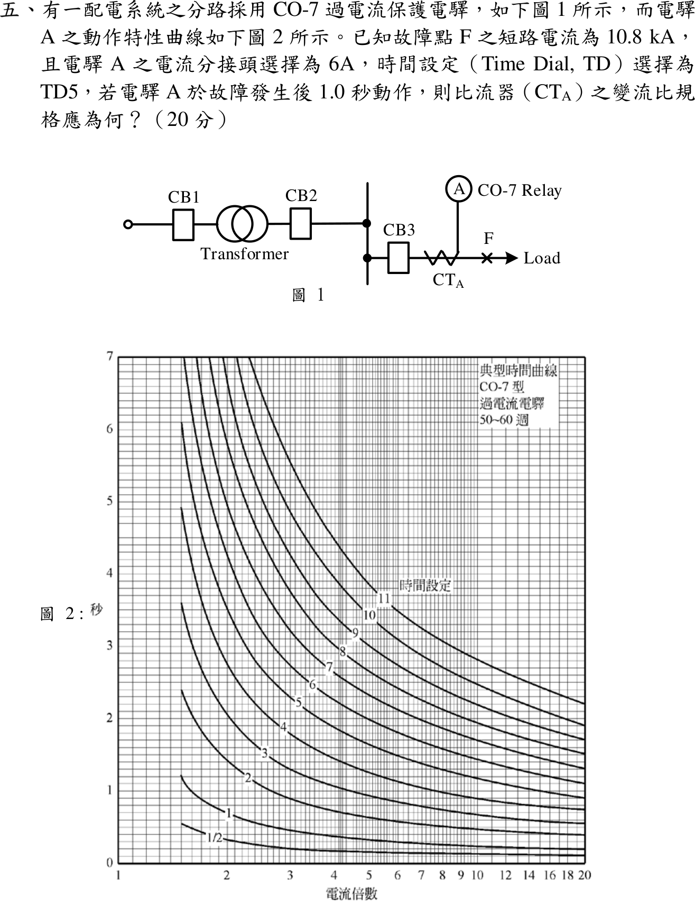
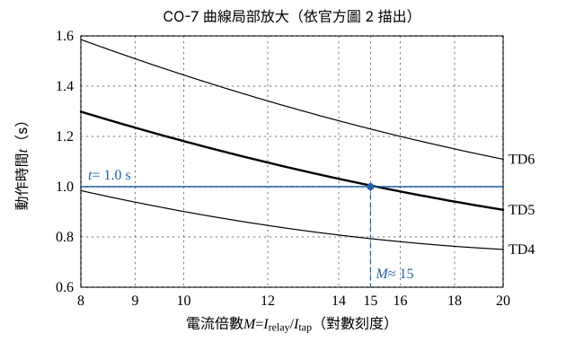

# 113 年工業配電第 5 題｜CO-7 電驛與比流器變流比

## 已知與所求

故障點 F 短路電流 \(10.8\,\mathrm{kA}\)；電驛 A 分接頭 \(6\,\mathrm A\)、時間設定 TD5；故障後 \(1.0\,\mathrm s\) 動作；圖 2 為 CO-7 時間曲線（橫軸電流倍數 1–20 對數刻度，縱軸 0–7 s）。求 \(\mathrm{CT_A}\) 變流比。

## 考場標準作答

**解題邏輯**：CO-7 的動作時間只由時間設定 TD 與電流倍數 \(M=I_{\text{relay}}/I_{\text{tap}}\) 決定。已知 TD5 與動作時間 1.0 s，先在圖 2 讀出 TD5 曲線上 1.0 s 對應的倍數 \(M\)；再由 \(I_{\text{relay}}=M\,I_{\text{tap}}\) 得電驛電流；電驛接在 \(\mathrm{CT_A}\) 二次側，\(I_{\text{relay}}=I_F\times5/N_p\)，反解一次額定 \(N_p\)，最後取標準規格。前提：CT 二次額定 5 A、電驛直接接 CT 二次（無輔助 CT）、故障點 F 在 \(\mathrm{CT_A}\) 下游所以 10.8 kA 全數流過 \(\mathrm{CT_A}\)、CT 不飽和。圖 1 的 CB1、CB2 與變壓器只交代系統位置，不參與計算。

### 步驟 1：由 CO-7 曲線讀電流倍數

**邏輯**：TD 已定為 5，只看 TD5 那一條；沿縱軸 \(t=1.0\,\mathrm s\) 畫水平線，與 TD5 的交點橫座標就是所需倍數。

- 橫軸為對數刻度，14 與 16 之間的格線依序為 15。
- TD5 曲線讀值：倍數 14 約 \(1.04\,\mathrm s\)、15 約 \(1.01\,\mathrm s\)、18 約 \(0.95\,\mathrm s\)；\(1.0\,\mathrm s\) 落在 15 附近。

\[
M=\frac{I_{\text{relay}}}{I_{\text{tap}}}\approx15
\]

### 比流器變流比（20 分）

**邏輯**：電驛電流 \(=M\times\) 分接頭電流；同一電流又等於故障電流按 CT 比降到二次側的值，兩式相等即可反解 CT 一次額定，再取最接近的標準規格。

電驛二次電流：
\[
I_{\text{relay}}=M\,I_{\text{tap}}=15\times6=90\,\mathrm A
\]
CT 一次額定（二次額定 5 A）：
\[
I_{\text{relay}}=I_F\times\frac{5}{N_p}\quad\Rightarrow\quad N_p=\frac{5\,I_F}{I_{\text{relay}}}
\]
\[
N_p=\frac{5\times10\,800}{90}=\frac{54\,000}{90}=600\,\mathrm A
\]
變流比：
\[
\mathrm{CTR}=\frac{N_p}{5}=\frac{600}{5}=120
\]
\[
\boxed{\mathrm{CT_A}=600/5\,\mathrm A}
\]
曲線讀值約有 \(\pm0.2\) 倍誤差：若讀 \(M=15.2\)，\(N_p=54\,000/(15.2\times6)=54\,000/91.2=592.1\,\mathrm A\)，最接近的標準規格仍是 \(600/5\)。

## 驗算

- 回代：\(I_{\text{relay}}=10\,800\times\dfrac{5}{600}=90\,\mathrm A\)，\(M=90/6=15\) 倍，圖上 TD5 在 15 倍約 \(1.0\,\mathrm s\)。
- 鄰近標準比：\(500/5\) 得 \(10\,800\times5/500=108\,\mathrm A\)、\(M=18\)（約 \(0.95\,\mathrm s\)）；\(750/5\) 得 \(72\,\mathrm A\)、\(M=12\)（約 \(1.10\,\mathrm s\)），皆偏離 1.0 s 較多。

## 失分點

- 讀錯曲線：倍數 6 在 TD5 上約 \(1.5\,\mathrm s\)（1.0 s 附近的是 TD3–TD4），若取 \(M=6\) 會得 \(1500/5\)。
- 電流倍數是相對分接頭 \(6\,\mathrm A\)，不是相對 CT 二次額定 \(5\,\mathrm A\)。
- 只答 CTR \(=120\) 未寫成標準規格 \(600/5\,\mathrm A\)。
