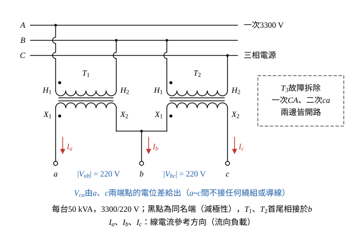
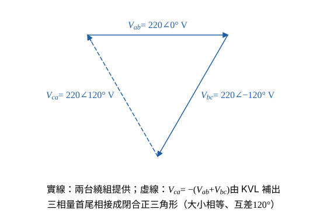

# 114 年工業配電第 1 題｜開三角（V-V）緊急供電

## 已知與所求

三台單相變壓器各 \(50\,\mathrm{kVA}\)、\(3300/220\,\mathrm{V}\)，原為 \(\Delta\text{-}\Delta\) 供三相負載；其中一台故障。求（一）繪圖說明改接開 \(\Delta\)（V-V）；（二）改接後可供應之最大負載。

## 考場標準作答

### （一）開三角（V-V）接線（10 分）

設兩台為規格相同的理想變壓器，負載平衡，一次為正相序（\(A\to B\to C\)），以二次側 \(220\,\mathrm V\) 計算。接線畫法：
- 拆除故障的 \(T_3\)（原跨一次 \(CA\)、二次 \(ca\)），一次、二次兩處都保持開路，不可短接。
- \(T_1\) 一次 \(H_1\)–\(H_2\) 接 \(A\)–\(B\)，\(T_2\) 一次 \(H_1\)–\(H_2\) 接 \(B\)–\(C\)；二次 \(T_1\) 的 \(X_1\) 引出 a，\(T_1\) 的 \(X_2\) 與 \(T_2\) 的 \(X_1\) 相接引出 b，\(T_2\) 的 \(X_2\) 引出 c。
- 每台 \(3300/220\,\mathrm{V}\)，故 \(|V_{ab}|=|V_{bc}|=220\,\mathrm V\)。

每台二次電壓與其一次所跨的線電壓同相（減極性、同名端對應），兩台二次首尾相接後，第三邊電壓由 KVL 補出。兩個由繞組提供的線電壓（以 \(V_{ab}\) 為參考，正相序 \(V_{bc}\) 落後 \(120^\circ\)）：
\[
V_{ab}=220\angle0^\circ\,\mathrm V,\qquad V_{bc}=220\angle-120^\circ\,\mathrm V
\]
沿 \(a\to b\to c\to a\) 的 KVL：
\[
V_{ab}+V_{bc}+V_{ca}=0\ \Rightarrow\ V_{ca}=-(V_{ab}+V_{bc})
\]
化成直角座標相加（\(220\sin120^\circ=110\sqrt3\)）：
\[
V_{bc}=220(\cos120^\circ-j\sin120^\circ)=-110-j110\sqrt3\,\mathrm V
\]
\[
V_{ab}+V_{bc}=220+(-110-j110\sqrt3)=110-j110\sqrt3\,\mathrm V
\]
\[
V_{ca}=-(110-j110\sqrt3)=-110+j110\sqrt3\,\mathrm V
\]
換回極座標，大小與角度各一行（\(110\sqrt3\approx190.53\)）：
\[
|V_{ca}|=\sqrt{110^2+(110\sqrt3)^2}=110\sqrt{1+3}=220\,\mathrm V
\]
\[
\angle V_{ca}=180^\circ-\tan^{-1}\frac{110\sqrt3}{110}=180^\circ-60^\circ=120^\circ
\]

三個線電壓 \(220\angle0^\circ\)、\(220\angle-120^\circ\)、\(220\angle120^\circ\,\mathrm V\) 大小相等、互差 \(120^\circ\)，為平衡三相。

\[
\boxed{\text{兩台單相變壓器接成開 }\Delta\text{（V-V），第三邊開路，仍輸出三相 }220\,\mathrm{V}}
\]

### （二）改接後可供應之最大負載（10 分）

開三角的線 a 只接 \(T_1\)、線 c 只接 \(T_2\)，線電流上限＝單台繞組額定電流。單台二次額定電流：
\[
I_{2N}=\frac{S_{1\phi}}{V_2}=\frac{50\,000}{220}=227.27\,\mathrm{A}
\]
KCL（圖 1 參考方向：線電流流向負載；繞組電流 \(I_{T1}\) 定義為由 \(T_1\) 的 a 端流出、\(I_{T2}\) 由 \(T_2\) 的 c 端流出）：
\[
\text{節點 a：}I_a=I_{T1},\qquad \text{節點 c：}I_c=I_{T2}
\]
平衡負載 \(|I_a|=|I_b|=|I_c|=I_L\)，故兩繞組電流大小都等於 \(I_L\)，同時達額定：
\[
I_L\le I_{2N}
\]
三相容量（\(I_{2N}\) 以分數 \(50\,000/220\) 代入，\(220\) 約去）：
\[
S_{3\phi,\max}=\sqrt3\,V_LI_{2N}=\sqrt3(220)\left(\frac{50\,000}{220}\right)=\sqrt3(50\,000)=86\,602.54\,\mathrm{VA}
\]
\[
\boxed{S_{3\phi,\max}=86.60\,\mathrm{kVA}}
\]
與原容量及剩餘設備容量比較（同樣以精確式計算）：
\[
\frac{S_{3\phi,\max}}{3S_{1\phi}}=\frac{\sqrt3(50)}{150}=\frac{1}{\sqrt3}=0.5774=57.74\%
\]
\[
\frac{S_{3\phi,\max}}{2S_{1\phi}}=\frac{\sqrt3(50)}{100}=\frac{\sqrt3}{2}=0.8660=86.60\%
\]
即原 \(150\,\mathrm{kVA}\) 的 \(57.74\%\)，剩餘兩台設備容量 \(100\,\mathrm{kVA}\) 的 \(86.60\%\)。題目未給功率因數，故答案以 kVA 表示，不寫成 kW。

## 驗算

### 獨立驗算

容量公式 \(S_{VV}=\sqrt3S_{1\phi}=\sqrt3(50)=86.60\,\mathrm{kVA}\)，與繞組電流法一致。平衡線電流 \(I_a=I\angle0^\circ\)、\(I_c=I\angle120^\circ\) 由 KCL 各自全部流經 ab、bc 繞組，兩繞組電流大小皆為 \(I\)，同時達額定，無一台先過載。

## 失分點

- 把剩餘兩台直接相加成 \(100\,\mathrm{kVA}\)；兩台各輸出 \(50\,\mathrm{kVA}\)，但複功率相角差 \(60^\circ\)，合成只得 \(2(50)\cos30^\circ=86.60\,\mathrm{kVA}\)。
- \(57.74\%\) 與 \(86.60\%\) 的分母不同（原三台 \(150\) 與剩餘兩台 \(100\,\mathrm{kVA}\)），須標明。
- 圖中把空缺的第三邊畫成導線，會造成短路。
