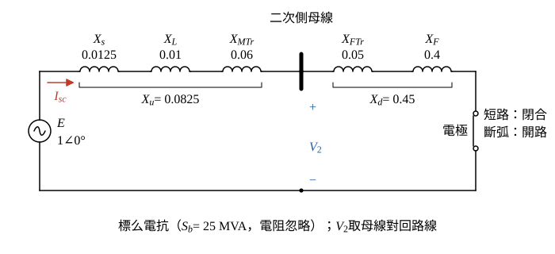

# 114 年工業配電第 2 題｜電弧爐壓降與閃爍電壓變動

## 已知與所求

基準 \(25\,\mathrm{MVA}\)；系統短路容量 \(2000\,\mathrm{MVA}\)，\(Z_L=j0.01\)、\(Z_{MTr}=j0.06\)、\(Z_{FTr}=j0.05\)、電弧爐及其配線 \(Z_F=j0.4\,\mathrm{pu}\)，電阻忽略。圖示串聯順序：電源—\(Z_s\)—\(Z_L\)—主變—二次側母線—爐變—\(Z_F\)—爐 F。求（一）電極短路與斷弧時主變二次側百分壓降；（二）二次側閃爍電壓變動率。

本題 \(Z_F\) 在電極短路時剩餘多少未明定，以下為條件主解，見「條件與疑義」。

## 考場標準作答

**解題邏輯**：全部換到 \(25\,\mathrm{MVA}\) 共同基準，電阻忽略。前提：電源電壓 \(\underline E=1\angle0^\circ\,\mathrm{pu}\)（短路容量換成串聯電抗、無其他負載電流）；電極短路時 \(Z_F=j0.4\) 全數保留在迴路中（條件主解，見「條件與疑義」）；「50 噸」「69 kV」只說明設備與電壓等級，不參與標么計算。
1. 網路是一條純電抗串聯迴路：電源 \(\underline E\) → 上游 \(X_u\)（電源＋線路＋主變）→ 主變二次側母線 → 下游 \(X_d\)（爐變＋電弧爐及其配線）→ 電極。
2. 電極短路時迴路閉合、電流由總電抗決定，母線電壓 \(=\underline E-\underline I_{sc}(jX_u)\)。
3. 斷弧時迴路開路、電流為零、母線電壓等於 \(\underline E\)。
4. 閃爍電壓變動率取兩極端狀態的母線電壓差。

### 步驟 1：各元件標么電抗（25 MVA 基準）

電源電抗由短路容量換算：
\[
X_s=\frac{S_b}{S_{sc}}=\frac{25}{2000}=0.0125\ \mathrm{pu}
\]
其餘題給值已在 \(25\,\mathrm{MVA}\) 基準（主變、爐變容量皆為 25 MVA），直接取用：
\[
X_L=0.01\ \mathrm{pu},\qquad X_{MTr}=0.06\ \mathrm{pu},\qquad X_{FTr}=0.05\ \mathrm{pu},\qquad X_F=0.4\ \mathrm{pu}
\]

### 步驟 2：量測點上、下游合成電抗

量測點是主變二次側母線；母線上游為 \(X_s\)、\(X_L\)、\(X_{MTr}\) 串聯：
\[
X_u=X_s+X_L+X_{MTr}=0.0125+0.01+0.06=0.0825\ \mathrm{pu}
\]
母線下游為 \(X_{FTr}\)、\(X_F\) 串聯：
\[
X_d=X_{FTr}+X_F=0.05+0.4=0.45\ \mathrm{pu}
\]
迴路總電抗：
\[
X_u+X_d=0.0825+0.45=0.5325\ \mathrm{pu}
\]

畫法：電源 \(\underline E\) 在左，上方導線依序串 \(X_s\)、\(X_L\)、\(X_{MTr}\) 到二次側母線，再串 \(X_{FTr}\)、\(X_F\) 到電極；電極以開關表示（短路＝閉合、斷弧＝開路）接回路線。電流參考方向由電源流向電爐；母線電壓 \(\underline V_2\) 取母線對回路線（短路時記 \(\underline V_{2,sc}\)、斷弧時記 \(\underline V_{2,open}\)）。圖中相量以大小符號標示（不加底線）。

### （一）電極短路與斷弧時的百分壓降（10 分）

**邏輯**：電極短路時迴路閉合，以 \(\underline I_{sc}=\underline E/[j(X_u+X_d)]\) 求電流，再用 KVL 由電源扣掉上游電抗壓降得母線電壓；斷弧時迴路開路，電流為零，上游無壓降。壓降以額定電壓 \(1\,\mathrm{pu}\) 為分母。

電極短路的電流：
\[
\underline I_{sc}=\frac{\underline E}{j(X_u+X_d)}=\frac1{j0.5325}
\]
\[
|\underline I_{sc}|=\frac{1}{0.5325}=1.878\ \mathrm{pu},\qquad \angle\underline I_{sc}=0^\circ-90^\circ=-90^\circ
\]
\[
\underline I_{sc}=-j1.878\ \mathrm{pu}
\]
上游電抗上的壓降：
\[
\underline I_{sc}(jX_u)=(-j1.878)(j0.0825)=1.878\times0.0825=0.1549\ \mathrm{pu}
\]
母線電壓（KVL）：
\[
\underline V_{2,sc}=\underline E-\underline I_{sc}(jX_u)=1-0.1549=0.8451\ \mathrm{pu}
\]
\[
|\underline V_{2,sc}|=0.8451\ \mathrm{pu},\qquad \angle\underline V_{2,sc}=0^\circ
\]
短路時壓降：
\[
\Delta V_{sc}=\frac{1-|\underline V_{2,sc}|}{1}\times100\%=(1-0.8451)\times100\%
\]
\[
\Delta V_{sc}=\boxed{15.49\%}
\]
斷弧時迴路開路：
\[
\underline I_{open}=0,\qquad \underline V_{2,open}=\underline E-0\times(jX_u)=1\ \mathrm{pu}
\]
\[
\Delta V_{open}=\frac{1-1}{1}\times100\%=\boxed{0\%}
\]

### （二）主變二次側閃爍電壓變動率（10 分）

**邏輯**：電弧爐在斷弧與電極短路兩極端間反覆切換，母線電壓在兩值之間擺動；變動率取兩狀態母線電壓之差除以額定電壓（1 pu），兩值都由（一）求得。

\[
|\underline V_{2,open}|=1\ \mathrm{pu},\qquad |\underline V_{2,sc}|=0.8451\ \mathrm{pu}
\]
\[
\Delta V\%=\frac{|\underline V_{2,open}|-|\underline V_{2,sc}|}{V_{rated}}\times100\%=\frac{1-0.8451}{1}\times100\%
\]
\[
\Delta V\%=0.1549\times100\%
\]
\[
\boxed{\Delta V\%=15.49\%}
\]
此為最大電壓變動率，不是閃爍嚴重度 \(P_{st}\)。

## 驗算

- 分壓式獨立求母線電壓：\(\underline V_{2,sc}=\underline E\dfrac{jX_d}{j(X_u+X_d)}=\dfrac{0.45}{0.5325}=0.8451\ \mathrm{pu}\)，與 KVL 結果相同。
- KVL 全迴路：\(|\underline I_{sc}|(X_u+X_d)=1.878\times0.5325=1.000\ \mathrm{pu}=|\underline E|\)。
- 壓降比例：\(\Delta V_{sc}=\dfrac{X_u}{X_u+X_d}=\dfrac{0.0825}{0.5325}=15.49\%\)。

## 失分點

- \(X_s\) 寫成 \(2000/25\)，或未換到 \(25\,\mathrm{MVA}\) 共同基準。
- 把爐變算在量測點上游；量測點在主變二次側，上游只含 \(X_s+X_L+X_{MTr}\)。
- 把母線電壓誤當電極電壓；短路時電極電壓為零，母線電壓為 \(0.8451\,\mathrm{pu}\)。

## 條件與疑義

原題稱 \(Z_F\) 為「電弧爐及其配線之等效阻抗」，未拆分固定配線與隨電弧狀態改變的部分，因此不能據此宣稱唯一答案。官方圖將 \(Z_F\) 畫在爐 F 前方，且沒有畫出繞過 \(Z_F\) 的短接支路，支持全部保留的條件主解 \(15.49\%\)（總電抗 \(0.5325\,\mathrm{pu}\)）。

令短路時剩餘電抗為 \(X_{F,sc}\)，共同式為
\[
\Delta V\%=\frac{0.0825}{0.0825+0.05+X_{F,sc}}\times100\%
\]
\(X_{F,sc}=0.4\) 得 \(15.49\%\)；\(X_{F,sc}=0\) 得 \(62.26\%\)。兩值都未經官方評分答案確認；取得 \(Z_F\) 的短路定義後應依該證據定案。
