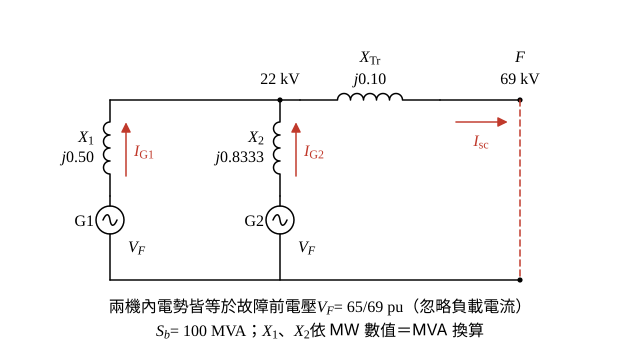

# 114 年工業配電第 3 題｜汽電共生系統三相短路

## 已知與所求

發電機 1 為 \(50\,\mathrm{MW}\)、發電機 2 為 \(30\,\mathrm{MW}\)，\(X''_d\) 均為 \(25\%\)（各自額定基準），並聯後經 \(100\,\mathrm{MVA}\)、\(X_{Tr}=10\%\)、\(22/69\,\mathrm{kV}\ (\Delta/\mathrm Y)\) 變壓器升壓；故障前高壓側 \(65\,\mathrm{kV}\)，忽略負載電流；基準 \(100\,\mathrm{MVA}\)。求（一）69 kV 側三相短路電流 pu；（二）各發電機次暫態短路電流 A。

題目未給額定 MVA 或功率因數；以下主解採 \(c_1=c_2=1.0\)（MW 數值＝MVA）條件，見「條件與疑義」。

## 考場標準作答

**解題邏輯**：三相故障用戴維寧等效：忽略負載電流時，故障前各電源內電勢都等於故障前電壓 \(V_F=65/69\,\mathrm{pu}\)，故從故障點看入的戴維寧電抗 = 兩機次暫態電抗並聯 + 變壓器電抗。依序把兩機電抗換到 \(100\,\mathrm{MVA}\) 基準 → 合成 \(X_{th}\) → 求（一）\(I_{sc}=V_F/X_{th}\) → （二）兩機依電抗反比分流，再以 22 kV 側基準電流換成安培。主解採 MW 數值＝MVA（PF = 1）條件，見「條件與疑義」。

### 步驟 1：換到 \(S_b=100\,\mathrm{MVA}\) 基準

標么電抗換基準：\(X_{new}=X_{old}\dfrac{S_{b,new}}{S_{rated}}\)（電壓基準與額定相同，不需電壓修正）。
\[
X_1=0.25\times\frac{100}{50}=0.25\times2=0.50\,\mathrm{pu}
\]
\[
X_2=0.25\times\frac{100}{30}=\frac{25}{30}=\frac56=0.8333\,\mathrm{pu}
\]
變壓器額定即 \(100\,\mathrm{MVA}\)，不必換算：\(X_{Tr}=0.10\,\mathrm{pu}\)。

### 步驟 2：等效電路與戴維寧電抗

- 兩機各以電壓源 \(V_F\) 串 \(jX_1\)、\(jX_2\) 接到 22 kV 發電機母線（兩機並聯）。
- 母線再串 \(jX_{Tr}\) 到 69 kV 側故障點 F；F 對參考點短路。
- Δ/Y 相移只改變相角、不改變電流大小，以大小計算即可。

\[
X_1\parallel X_2=\frac{X_1X_2}{X_1+X_2}=\frac{0.5\times\frac56}{0.5+\frac56}=\frac{5/12}{4/3}=\frac{5}{16}=0.3125\,\mathrm{pu}
\]
\[
X_{th}=X_1\parallel X_2+X_{Tr}=0.3125+0.10=0.4125\,\mathrm{pu}
\]

### （一）變壓器 69 kV 側三相短路電流 pu（10 分）

**邏輯**：故障前電壓即戴維寧電壓（負載電流忽略），短路電流 = \(V_F/X_{th}\)；\(V_F\) 以 69 kV 為電壓基準化為標么值。

\[
V_F=\frac{65}{69}=0.94203\,\mathrm{pu}
\]
\[
I_{sc}=\frac{V_F}{X_{th}}=\frac{0.94203}{0.4125}=2.2837\,\mathrm{pu}
\]
\[
\boxed{I_{sc}=2.28\,\mathrm{pu}}
\]

### （二）各發電機次暫態短路電流 A（10 分）

**邏輯**：兩機並聯、內電勢相同，故障電流依電抗反比分配；機組在 22 kV 側，所以用 22 kV 基準電流把 pu 換成安培。

22 kV 側基準電流：
\[
I_b=\frac{S_b}{\sqrt3V_b}=\frac{100\times10^6}{\sqrt3\times22\times10^3}=\frac{100\times10^6}{38\,105.12}=2624.32\,\mathrm A
\]
分流比：
\[
\frac{I_{G1}}{I_{sc}}=\frac{X_2}{X_1+X_2}=\frac{5/6}{4/3}=\frac58=0.625,\qquad
\frac{I_{G2}}{I_{sc}}=\frac{X_1}{X_1+X_2}=\frac{0.5}{4/3}=\frac38=0.375
\]
發電機 1（以完整精度的 \(I_{sc}=2.2837066\) 相乘）：
\[
I_{G1,pu}=0.625\times2.2837066=1.4273166\,\mathrm{pu}
\]
\[
I_{G1}=1.4273166\times2624.3194=3745.73\,\mathrm A
\]
\[
\boxed{I_{G1}=3745.73\,\mathrm A}
\]
發電機 2：
\[
I_{G2,pu}=0.375\times2.2837066=0.8563900\,\mathrm{pu}
\]
\[
I_{G2}=0.8563900\times2624.3194=2247.44\,\mathrm A
\]
\[
\boxed{I_{G2}=2247.44\,\mathrm A}
\]

## 驗算

節點法：69 kV 側短路時，發電機母線電壓 \(V_g=I_{sc}X_{Tr}=2.2837\times0.10=0.22837\,\mathrm{pu}\)；各機電流 \((V_F-V_g)/X_i\)：\(V_F-V_g=0.94203-0.22837=0.71366\)，\(0.71366/0.5=1.4273\,\mathrm{pu}\)、\(0.71366/0.8333=0.8564\,\mathrm{pu}\)，和 \(=2.2837\,\mathrm{pu}=I_{sc}\)，KCL 成立；換算成安培 \(3745.73+2247.44=5993.17\,\mathrm A\approx I_{sc}I_b=2.2837066\times2624.3194=5993.18\,\mathrm A\)（差在末位進位）。

## 失分點

- 兩機直接以 \(0.25\,\mathrm{pu}\) 並聯，未換到 \(100\,\mathrm{MVA}\) 基準。
- 用 \(V_F=1\) 而忽略 \(65/69=0.94\,\mathrm{pu}\)。
- 發電機電流用 69 kV 基準電流 \(836.74\,\mathrm A\) 換算；機組電流應在 22 kV 側。

## 條件與疑義

標么電抗的機組基準是額定 MVA，但題面只給 \(50\,\mathrm{MW}\)、\(30\,\mathrm{MW}\)。若額定 MVA 為 \(S_1,S_2\)：
\[
I_{sc}=\frac{65/69}{0.1+25/(S_1+S_2)},\qquad I_{Gi}=\frac{S_i}{S_1+S_2}I_{sc}I_b
\]

| 額定功率因數假設 | \((S_1,S_2)\) | \(I_{sc}\) | \(I_{G1}\) | \(I_{G2}\) |
| --- | --- | ---: | ---: | ---: |
| \(c_1=c_2=1.0\) | \((50,30)\,\mathrm{MVA}\) | \(2.2837\,\mathrm{pu}\) | \(3745.7\,\mathrm A\) | \(2247.4\,\mathrm A\) |
| \(c_1=c_2=0.8\) | \((62.5,37.5)\,\mathrm{MVA}\) | \(2.6915\,\mathrm{pu}\) | \(4414.6\,\mathrm A\) | \(2648.8\,\mathrm A\) |

未取得額定功率因數前，不選任一列為唯一答案。
