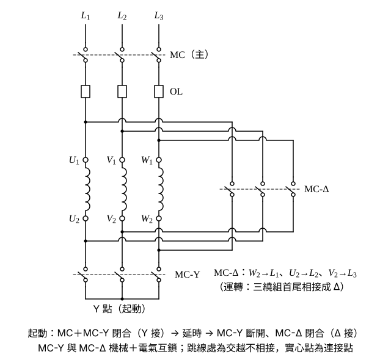
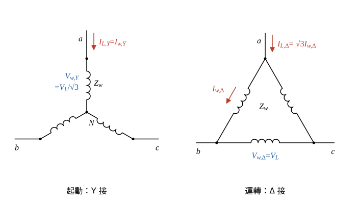
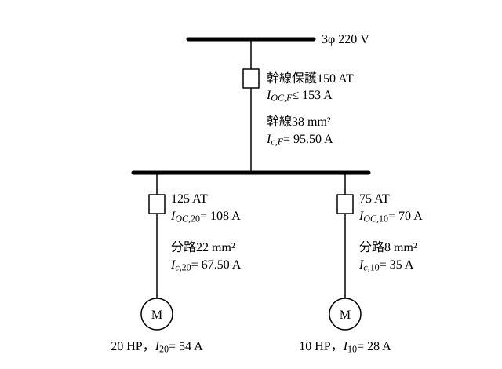

# 114 年工業配電第 4 題｜Y-Δ 起動與電動機線路設計

## 已知與所求

三相 \(220\,\mathrm V\) 電動機 \(20\,\mathrm{HP}\) 與 \(10\,\mathrm{HP}\) 各一台；20 HP 起動階級 E，起動 \(4.5\text{–}4.99\,\mathrm{kVA/HP}\)；PVC 配管。求（一）繪圖說明 Y-Δ 起動降低起動電流；（二）設計兩台線路，註明幹線／分路線徑與過電流保護斷路器 AT。滿載電流、安培容量與保護倍率須查表，所用表值列於「條件與疑義」。

## 考場標準作答

### （一）Y-Δ 起動降低起動電流（10 分）

設電動機為 Δ 接額定 220 V、引出 6 條線（\(U_1V_1W_1\)、\(U_2V_2W_2\)）的機型，Y-Δ 起動才適用。起動器主電路畫法：
- 電源 \(L_1\)、\(L_2\)、\(L_3\) 經主接觸器 MC、積熱電驛 OL 接到電動機繞組首端 \(U_1\)、\(V_1\)、\(W_1\)；OL 位於 MC-Δ 分接點之前，運轉時通過的是線電流，標置值取 \(I_{FL}\)（若 OL 串在繞組內則取 \(I_{FL}/\sqrt3\)）。
- 繞組尾端 \(U_2\)、\(V_2\)、\(W_2\) 經 MC-Y 短接成 Y 點（即圖 2 的中性點 \(N\)，起動）。
- 尾端另經 MC-Δ 接回電源線：\(W_2\to L_1\)、\(U_2\to L_2\)、\(V_2\to L_3\)，使 \(U\) 繞組跨 \(L_1L_2\)、\(V\) 繞組跨 \(L_2L_3\)、\(W\) 繞組跨 \(L_3L_1\)（運轉）。
- 動作順序：MC＋MC-Y 閉合起動 → 計時器延時 → MC-Y 斷開 → MC-Δ 閉合；MC-Y 與 MC-Δ 須機械＋電氣互鎖，不得同時閉合（否則電源經 Y 點短路）。

Δ 接（全壓）時，繞組電壓 \(V_{w,\Delta}=V_L\)，線電流為繞組電流的 \(\sqrt3\) 倍：
\[
I_{w,\Delta}=\frac{V_L}{Z_w},\qquad I_{L,\Delta}=\sqrt3\,I_{w,\Delta}=\frac{\sqrt3\,V_L}{Z_w}
\]
Y 接時，繞組電壓為相電壓 \(V_{w,Y}=V_L/\sqrt3\)，線電流＝繞組電流：
\[
I_{L,Y}=I_{w,Y}=\frac{V_L/\sqrt3}{Z_w}=\frac{V_L}{\sqrt3\,Z_w}
\]
兩式相除，\(V_L\)、\(Z_w\) 約去：
\[
\frac{I_{L,Y}}{I_{L,\Delta}}=\frac{V_L/(\sqrt3Z_w)}{\sqrt3V_L/Z_w}=\frac{1}{\sqrt3\cdot\sqrt3}=\frac13
\]
轉矩與繞組電壓平方成正比，故 \(T_Y/T_\Delta=(1/\sqrt3)^2=1/3\)（起動轉矩同樣降為 1/3）。

起動 kVA/HP 為全壓（Δ 接）堵轉值，20 HP 全壓起動容量為 \((4.5\text{–}4.99)\,\mathrm{kVA/HP}\times20\,\mathrm{HP}\)，換算全壓起動線電流。分母 \(\sqrt3(220)=381.05\)：
\[
I_{st,\Delta}=\frac{S_{st}}{\sqrt3\,V_L}=\frac{(4.5\text{–}4.99)(20)\ \mathrm{kVA}}{\sqrt3\times0.22\ \mathrm{kV}}=\frac{90\text{–}99.8\ \mathrm{kVA}}{0.38105\ \mathrm{kV}}=236.19\text{–}261.91\,\mathrm A
\]
Y 起動線電流為全壓的 \(1/3\)：
\[
I_{st,Y}=\frac{I_{st,\Delta}}{3}=\frac{236.19\text{–}261.91}{3}
\]
\[
\boxed{I_{st,Y}=78.73\text{–}87.30\,\mathrm A}
\]

### （二）兩台電動機線路設計（10 分）

滿載電流（表值，見條件與疑義）：\(I_{20}=54\,\mathrm A\)、\(I_{10}=28\,\mathrm A\)。

每台一條分路、兩台共用一條幹線，導線依連續電流選。20 HP 分路導線：
\[
I_{c,20}=1.25I_{20}=1.25(54)=67.50\,\mathrm A\ \Rightarrow\ 22\,\mathrm{mm^2}\ (70\,\mathrm A)
\]
10 HP 分路導線：
\[
I_{c,10}=1.25I_{10}=1.25(28)=35\,\mathrm A\ \Rightarrow\ 8\,\mathrm{mm^2}\ (40\,\mathrm A)
\]
幹線導線（最大一台 20 HP 乘 1.25，10 HP 以滿載計入）：
\[
I_{c,F}=1.25I_{20}+I_{10}=67.50+28=95.50\,\mathrm A\ \Rightarrow\ 38\,\mathrm{mm^2}\ (100\,\mathrm A)
\]
分路斷路器作短路保護，倍率乘滿載電流後向上取標準 AT（往下取會在起動時誤跳）；電動機過載由 OL 保護，故斷路器 AT 可大於導線安培容量。20 HP 分路斷路器（起動階級 E，倍率 200%）：
\[
I_{OC,20}=2.00I_{20}=2.00(54)=108\,\mathrm A\ \Rightarrow\ 125\,\mathrm{AT}
\]
10 HP 分路斷路器（題目未給起動階級，取 250%）：
\[
I_{OC,10}=2.50I_{10}=2.50(28)=70\,\mathrm A\ \Rightarrow\ 75\,\mathrm{AT}
\]
幹線斷路器向下取標準 AT，上限（最大分路 125 AT＋10 HP 滿載）：
\[
I_{OC,F}\le\mathrm{AT}_{20}+I_{10}=125+28=153\,\mathrm A\ \Rightarrow\ 150\,\mathrm{AT}\ \text{（向下取標準值）}
\]
並檢核 \(150\,\mathrm{AT}\ge125\,\mathrm{AT}\)（幹線不小於最大分路，協調成立）。

\[
\boxed{\text{20 HP 分路 }22\,\mathrm{mm^2}\text{、}125\,\mathrm{AT}；\ \text{10 HP 分路 }8\,\mathrm{mm^2}\text{、}75\,\mathrm{AT}；\ \text{幹線 }38\,\mathrm{mm^2}\text{、}150\,\mathrm{AT}}
\]

## 驗算

Y 接相阻抗 \(Z_w\) 不變：Δ 全壓線電流 \(\sqrt3V_L/Z_w\)，Y 接線電流 \((V_L/\sqrt3)/Z_w\)，比值 \(1/3\)；\(261.91/3=87.30\,\mathrm A\)。另以功率核對：Y 接每相繞組電壓 \(1/\sqrt3\)、電流 \(1/\sqrt3\)，三相起動 kVA 為全壓的 \(1/3\)，與電流比一致。幹線 \(150\,\mathrm{AT}\ge125\,\mathrm{AT}\) 分路，且 \(\le153\,\mathrm A\) 上限，保護協調成立。

## 失分點

- Y 起動線電流寫成 \(1/\sqrt3\)；漏掉 Δ 線電流為繞組電流 \(\sqrt3\) 倍，正確為 \(1/3\)。
- 幹線斷路器取「往上」標準值（175 AT）會超過分路保護＋其他滿載的上限。
- 以起動電流選導線；導線依滿載電流 125%，起動電流只影響斷路器倍率。

## 條件與疑義

題幹未附屋內線路裝置規則的表格，下列為假設值（須以規則表核對），作答時應註明所依表別：

| 項目 | 假設值 |
|---|---|
| 220 V 三相滿載電流 | 20 HP：\(54\,\mathrm A\)；10 HP：\(28\,\mathrm A\) |
| PVC 管內 3 線安培容量 | \(5.5\,\mathrm{mm^2}\)：30 A；\(8\)：40 A；\(14\)：55 A；\(22\)：70 A；\(30\)：90 A；\(38\)：100 A |
| 反時限斷路器倍率 | 起動階級 B–E：200%；F–V：250%；10 HP 未給階級取 250% |
| 標準 AT | 50、60、75、100、125、150、175、200 |

選線取安培容量不小於需求的最小線徑：\(35\,\mathrm A\to8\,\mathrm{mm^2}\)（\(5.5\) 僅 30 A）、\(67.50\,\mathrm A\to22\,\mathrm{mm^2}\)（\(14\) 僅 55 A）、\(95.50\,\mathrm A\to38\,\mathrm{mm^2}\)（\(30\) 僅 90 A）。若 10 HP 同為階級 E，則 \(56\,\mathrm A\to60\,\mathrm{AT}\)，幹線仍為 150 AT。查表值不同時，線徑與 AT 須依同一方法重選。
