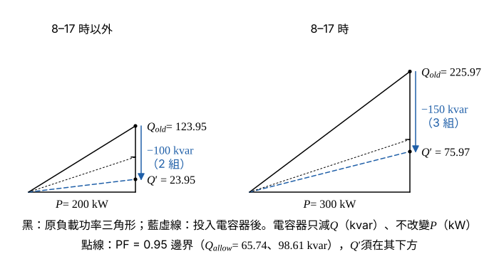

# 114 年工業配電第 5 題｜APFR 電容器分段投入

## 已知與所求

經常性負載 \(200\,\mathrm{kW}\)、PF \(0.85\) 落後（1–24 時）；新增 \(100\,\mathrm{kW}\)、PF \(0.7\) 落後（8–17 時）。目標全天 PF \(\ge0.95\) 落後；電容器 \(6\times50\,\mathrm{kvar}\) 可獨立投切。求（一）各時段需補償 kvar；（二）各時段實際投入組數、容量與實際 PF。

## 考場標準作答

### 步驟 1：各功率因數對應的 \(\tan\theta\)

\(Q=P\tan\theta\)，\(\tan\theta=\dfrac{\sqrt{1-\mathrm{PF}^2}}{\mathrm{PF}}\)（以下 \(Q\) 一律由此精確式直接計算，\(\tan\theta\) 的 4 位有效數字僅供參考）：
\[
\tan\theta_{0.85}=\frac{\sqrt{1-0.85^2}}{0.85}=\frac{\sqrt{0.2775}}{0.85}=0.6197
\]
\[
\tan\theta_{0.7}=\frac{\sqrt{1-0.7^2}}{0.7}=\frac{\sqrt{0.51}}{0.7}=1.020
\]
\[
\tan\theta_{0.95}=\frac{\sqrt{1-0.95^2}}{0.95}=\frac{\sqrt{0.0975}}{0.95}=0.3287
\]

### 步驟 2：兩時段的 \(P\)、\(Q_{old}\)

8–17 時以外（1–8 時、17–24 時）只有經常性負載：
\[
P=200\,\mathrm{kW},\qquad Q_{old}=200\tan\theta_{0.85}=\frac{200\sqrt{0.2775}}{0.85}=123.95\,\mathrm{kvar}
\]
8–17 時兩組負載同時運轉，有效、無效功率分別相加：
\[
Q_{new\,load}=100\tan\theta_{0.7}=\frac{100\sqrt{0.51}}{0.7}=102.02\,\mathrm{kvar}
\]
\[
P=200+100=300\,\mathrm{kW},\qquad Q_{old}=123.95+102.02=225.97\,\mathrm{kvar}
\]

### （一）各時段需補償的無效功率（10 分）

並聯電容器不改變 \(P\)，需補償量＝現有 \(Q\) − PF 0.95 時容許的 \(Q\)：
\[
Q_c=Q_{old}-Q_{allow}=Q_{old}-P\tan\theta_{0.95}
\]

**8–17 時以外**：
\[
Q_{allow}=200\tan\theta_{0.95}=\frac{200\sqrt{0.0975}}{0.95}=65.74\,\mathrm{kvar}
\]
\[
Q_c=123.95-65.74=\boxed{58.21\,\mathrm{kvar}}
\]

**8–17 時**：
\[
Q_{allow}=300\tan\theta_{0.95}=\frac{300\sqrt{0.0975}}{0.95}=98.61\,\mathrm{kvar}
\]
\[
Q_c=225.97-98.61=\boxed{127.36\,\mathrm{kvar}}
\]

### （二）實際投入組數、容量與功率因數（10 分）

每組 50 kvar 只能整組投切，取 \(n\ge Q_c/50\) 的最小整數（且 \(Q'>0\) 不過補償），實際 \(\mathrm{PF}=P/\sqrt{P^2+Q'^2}\)。

**8–17 時以外**：
\[
\frac{Q_c}{50}=\frac{58.21}{50}=1.164\Rightarrow n=2
\]
\[
\boxed{n=2\text{ 組}},\qquad \boxed{Q_{cap}=2\times50=100\,\mathrm{kvar}}
\]
\[
Q'=123.95-100=23.95\,\mathrm{kvar}
\]
\[
\sqrt{P^2+Q'^2}=\sqrt{200^2+23.95^2}=\sqrt{40000+573.6}=\sqrt{40573.6}=201.4\,\mathrm{kVA}
\]
\[
\mathrm{PF}=\frac{200}{201.4}=0.9930\Rightarrow\boxed{\mathrm{PF}=0.99\text{ 落後}}
\]

**8–17 時**：
\[
\frac{Q_c}{50}=\frac{127.36}{50}=2.547\Rightarrow n=3
\]
\[
\boxed{n=3\text{ 組}},\qquad \boxed{Q_{cap}=3\times50=150\,\mathrm{kvar}}
\]
\[
Q'=225.97-150=75.97\,\mathrm{kvar}
\]
\[
\sqrt{P^2+Q'^2}=\sqrt{300^2+75.97^2}=\sqrt{90000+5771}=\sqrt{95771}=309.5\,\mathrm{kVA}
\]
\[
\mathrm{PF}=\frac{300}{309.5}=0.9693\Rightarrow\boxed{\mathrm{PF}=0.97\text{ 落後}}
\]

## 驗算

少投一組：200 kW 時 \(Q'=73.95\,\mathrm{kvar}\)，\(\sqrt{40000+5469}=213.2\)，\(\mathrm{PF}=200/213.2=0.9381<0.95\)；300 kW 時 \(Q'=125.97\,\mathrm{kvar}\)，\(\sqrt{90000+15870}=325.4\)，\(\mathrm{PF}=300/325.4=0.9219<0.95\)。故 2 組、3 組為最少組數，且 \(Q'>0\) 未過補償。

## 失分點

- 8–17 時只算新增 100 kW 的 kvar，漏掉原 200 kW 的 \(123.95\,\mathrm{kvar}\)。
- 把 \(127.36\) 四捨五入成 2 組（100 kvar），PF 僅 \(0.92\)，未達 0.95。
- 只答理論 kvar，未答實際組數與投入後 PF。
